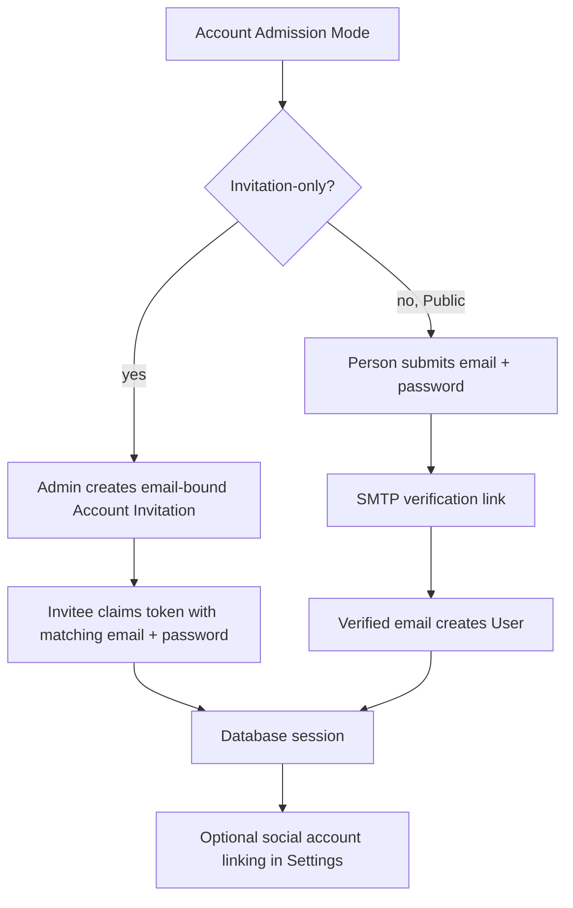

# Account admission and authentication methods

Account Admission decides whether a person may create a new global ReadWise
User. It is separate from sign-in: an existing User may authenticate with a
Password Credential and any explicitly Linked Social Accounts.

## Admission flow



## Account Admission Modes

`ACCOUNT_ADMISSION_MODE` accepts exactly two values:

| Mode | New User policy |
| --- | --- |
| `invitation-only` | Requires a pending, unexpired Account Invitation whose normalized email exactly matches the registration email. This is the default and invalid values fail closed to it. |
| `public` | Anyone may begin registration, but the User is not created until the email verification token is consumed. SMTP is required for a usable flow. |

There is no runtime “test mode.” Tests select one of the real policies.

## Password registration and sign-in

Password Credentials use Node's built-in `scrypt` with a random salt. Passwords
must be 12–128 characters. Plaintext passwords are never persisted or logged.

The project keeps NextAuth's database-session strategy. Password endpoints do
not use the NextAuth Credentials provider; after successful password
authentication they create a normal `Session` row and set the same hardened
NextAuth-compatible cookie:

- HttpOnly;
- `SameSite=Lax`;
- `Secure` with the `__Secure-` prefix in production;
- path `/`.

Public registration stores a short-lived pending registration containing the
password hash and verification-token hash. No User exists before verification.
Responses remain generic when an email already belongs to a User.

## Invitations

An Account Invitation is bound to one normalized email and defaults to a
seven-day lifetime. Only one pending invitation may exist for an email.

- Raw invitation tokens are returned only on create/rotate and may be emailed or
  copied once by an administrator.
- The database stores only a SHA-256 token hash.
- Claiming is atomic: User, Password Credential, invitation acceptance, and
  Session are committed together.
- Wrong-email claims do not consume the invitation.
- Accepted, revoked, expired, or rotated tokens cannot be reused.
- `/admin/invitations` and its APIs require `members.manage`.
- Audit records contain invitation ids, state, delivery outcome, and expiry only;
  they never contain recipient email or secret links.

SMTP is optional in Invitation-only mode because the admin UI exposes the
one-time link after create/rotate. Without SMTP, forgotten-password recovery is
unavailable until email delivery is configured.

## Password recovery

`POST /api/auth/password/forgot` always returns the same accepted response,
whether or not a Password Credential exists. A real credential receives a
single-use, one-hour reset link when SMTP is available.

Successful reset:

1. replaces the Password Credential hash;
2. clears the reset-token hash and expiry;
3. deletes every active Session for the User.

An authenticated social-only User may add a Password Credential in Settings.
An existing password user must prove the current password before changing it.

## Linked Social Accounts

Google and Azure AD are optional additional authentication methods. They never
create a ReadWise User.

- An unauthenticated social sign-in succeeds only when the exact
  `(provider, providerAccountId)` is already linked.
- An authenticated User may start linking from Settings.
- Linking requires the provider's verified normalized email to match the current
  User email.
- Google must report `email_verified=true`.
- Azure AD must provide both the OIDC subject and email.
- Automatic email-based account linking is disabled;
  `allowDangerousEmailAccountLinking` is not enabled.

This prevents an unlinked provider identity from taking over an existing
email-matching User.

## Operator bootstrap

No browser visitor is promoted automatically. Create the first administrator
explicitly:

```bash
printf '%s\n' "$READWISE_ADMIN_PASSWORD" |
  npm run bootstrap:admin -- \
  --email admin@example.com \
  --name "ReadWise Admin" \
  --password-stdin
```

The command refuses to change access after any Admin exists. When no Admin
exists, it either creates a verified Admin with a Password Credential or
promotes the matching existing User and replaces/adds that credential. The
password is accepted only through standard input and never appears in process
arguments or output.

## API surface

| Endpoint | Access | Purpose |
| --- | --- | --- |
| `POST /api/auth/register` | Public | Invitation claim or public pending registration, depending on mode. |
| `POST /api/auth/verify-email` | Public | Consume a public-registration verification token and create a Session. |
| `POST /api/auth/password/login` | Public | Authenticate a Password Credential and create a Session. |
| `POST /api/auth/password/forgot` | Public | Request a generic, anti-enumeration reset outcome. |
| `POST /api/auth/password/reset` | Public | Consume a reset token and revoke existing Sessions. |
| `POST /api/auth/invitation` | Public | Inspect a token through a masked, secret-free invitation view. |
| `GET /api/account/auth-methods` | Session | List password presence and linked provider names. |
| `PUT /api/account/auth-methods` | Session | Add or change the current User's Password Credential. |
| `GET`, `POST /api/admin/invitations` | `members.manage` | List or create Account Invitations. |
| `POST /api/admin/invitations/{id}/rotate` | `members.manage` | Invalidate the old token and issue a new one. |
| `DELETE /api/admin/invitations/{id}` | `members.manage` | Revoke a pending invitation. |

State-changing routes use the shared same-origin/CSRF guard. Public auth
requests are rate-limited by both trusted-proxy-aware IP key and a SHA-256
normalized-email key where an email is available.

## Email and runtime configuration

| Variable | Default / behavior |
| --- | --- |
| `ACCOUNT_ADMISSION_MODE` | `invitation-only`; accepts `invitation-only` or `public`. |
| `SMTP_URL` | Optional SMTP/SMTPS connection URL. Required for public registration and password-recovery delivery. |
| `EMAIL_FROM` | Sender identity paired with `SMTP_URL`. |
| `ACCOUNT_ADMISSION_RETENTION_DAYS` | `90`; retention for terminal invitation records. |
| `RATE_LIMIT_AUTH_REQUESTS` | `10` per shared rate-limit window by default. |
| `APP_URL` | Preferred public origin for generated invitation, verification, and reset links. Falls back to `NEXT_PUBLIC_APP_URL`, `NEXTAUTH_URL`, then `NEXT_PUBLIC_SITE_URL`. |

Leave invitation expiry blank to use the seven-day default. The admin UI exposes
an optional native date/time picker only when a custom expiry is needed.

`/api/ready` reports Account Admission and email delivery independently. Public
mode without both SMTP settings is degraded. Invalid admission mode is a
blocking auth configuration error.

## Retention and privacy

`npm run maintenance:retention -- --execute`:

- deletes expired pending registrations;
- clears expired password-reset token hashes;
- deletes terminal Account Invitations older than
  `ACCOUNT_ADMISSION_RETENTION_DAYS`.

Password hashes, reset tokens, invitation tokens, Session tokens, provider
tokens, email addresses, and secret links must never appear in logs, analytics,
audit metadata, or error context. User deletion cascades the Password Credential;
Account Invitation inviter/acceptor references use `SetNull` so the operational
record can follow its retention policy.

## Tests

Core coverage lives in:

- `tests/account-admission*.test.ts`;
- `tests/db/account-admission.test.ts`;
- `tests/auth-bootstrap.test.ts`;
- `tests/auth-providers.test.ts`;
- `tests/auth-security-backend.test.ts`.
