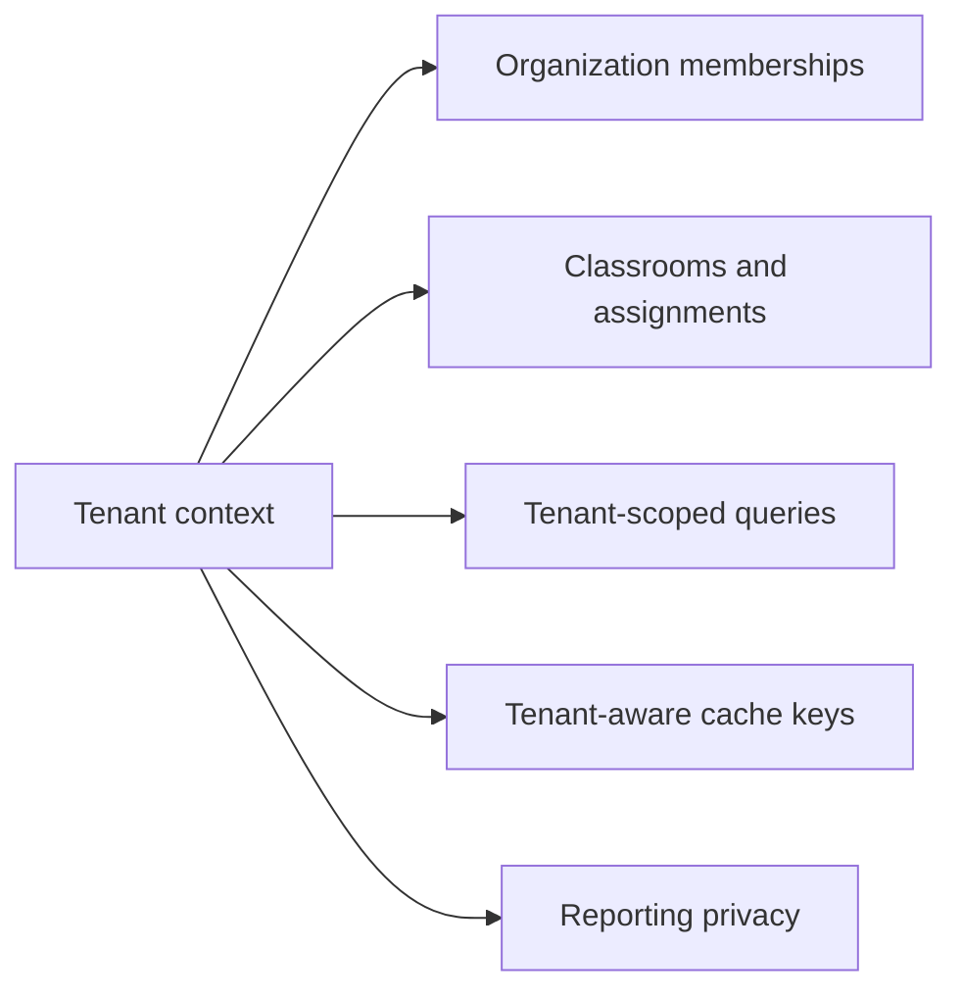

# Multi-tenancy, classrooms, tenant-aware cache & analytics (Epic RW-E012)

This document describes the multi-tenancy foundation added by RW-060..063:
organizations & memberships, classroom assignments & teacher workflows,
tenant-aware cache keys, and tenant-aware analytics & privacy rules.

The guiding principle is **additive, nullable, opt-in**: every tenancy feature is
inert until a user actually joins an organization. An account with no membership
behaves EXACTLY like the pre-tenancy single-user experience — no global/public
listing, cache key, or analytics surface changes for them.

## Tenant model

---

## 1. Tenancy model (RW-060)

### Entities

| Model | Purpose |
| --- | --- |
| `Organization` | The tenant boundary. `name`, unique `slug`, optional `settings` Json. |
| `Membership` | Joins a `User` to an `Organization` with a tenant `role`. `@@unique([userId, orgId])` — a user MAY belong to multiple orgs. Cascades with both. |
| `Classroom` | Belongs to an org; has one primary `teacherId`. |
| `ClassroomMembership` | Joins a `User` to a `Classroom` with a `ClassroomRole`. `@@unique([classroomId, userId])`. |
| `TextSet` / `TextSetItem` | Teacher-curated reading units owned within one organization (`PRIVATE` or `ORG`-shared with its teachers; never visible across organizations). Cascade with the organization; `ownerId` is `SetNull`. Assigned sets link classroom assignments through `Assignment.textSetId`. See [text sets](../learning/text-sets.md). |
| `ClassroomJoinCode` | At most one per classroom (`@@unique classroomId`): a unique self-enrollment `code` with optional `expiresAt` / `maxUses`, a `useCount`, and `disabledAt`. Cascades with the classroom; `createdById` is `SetNull` when the issuer is deleted. |
| `Assignment` | A `Classroom` ↔ `Article` reading assignment with optional `dueDate`/`instructions`. |
| `AssignmentCompletion` | A student's progress on an assignment (`status`, optional `quizScore`, `completedAt`). `@@unique([assignmentId, studentId])`. |

`AssignmentStatus` values are `ASSIGNED`, `IN_PROGRESS`, and `COMPLETED` (mapped
to `assigned`, `in_progress`, `completed` in the database). A completion row is
created/updated for the authenticated student only; student ids are never taken
from the request body.

### Roles — two independent axes

- **Global `Role`** (`Admin` | `Reader`) lives on `session.user.role`. A global
  `Admin` is a ReadWise *system* admin and is treated as a **super-user across
  every org** (defense-in-depth).
- **Tenant `MembershipRole`** (`OrgAdmin` | `Teacher` | `Member` | `Student`)
  lives on `Membership` rows. It does NOT change the global role: an `OrgAdmin`
  is not a system admin.
- **`ClassroomRole`** (`Teacher` | `Student`) lives on `ClassroomMembership`.

Tenant capabilities resolve through the SAME `@/lib/rbac` capability table as
global roles. `membershipCapabilities(role)` / `membershipHasCapability(role,
cap)` map a tenant role onto capabilities, so a `Teacher` membership yields
`classroom.manage`, an `OrgAdmin` yields `org.manage` + `org.members.manage` +
classroom caps, and `Member`/`Student` carry only the base reader capabilities.

### Ownership / tenant scoping

Resources that can become tenant-scoped carry a **nullable** owner column:

- `Article.organizationId String?` — `null` means **global/public** content
  (the default, unchanged). A non-null value scopes the article to one org.

`organizationId` is a **soft (non-FK) scalar**, mirroring the existing
`AnalyticsEvent`/`AuditLog` plain-string-reference convention. This is a
deliberate SQLite decision: adding a real relation column forces a table rebuild
that would disrupt the FTS5 triggers on `Article`. The PostgreSQL schema keeps it
as a plain indexed `TEXT` column too, so the two databases stay in lockstep.
Referential integrity for org ownership is enforced in application code.

`src/lib/article-library/tenant-integrity.ts` is the central integrity seam for
this soft reference. It provides:

- `orgScopedArticleWhere(orgId)` for ORG article read predicates.
- `validateArticleOrganizationIntegrity(article, operation, { expectedOrgId })`
  for create/update/read/delete code paths that accept or mutate org-scoped
  articles.
- `getOrganizationAssignableArticle(articleId, orgId)` for classroom assignment
  writes, returning 404 for cross-org articles and 409 for orphaned/malformed
  org references.
- `findArticleOrganizationIntegrityIssues()` for orphan detection.

> **Why null = public:** existing rows have `organizationId = NULL`, so every
> public listing and cache key behaves identically after the migration. Tenancy
> is purely opt-in.

### Helpers — `src/lib/org/`

- `createOrganization(input, creatorUserId)` — creates the org and seats the
  creator as its first `OrgAdmin`, in one transaction.
- `addMember` / `updateMemberRole` / `removeMember` — membership CRUD. Role
  changes and removals **refuse to drop the last `OrgAdmin`** (a tenant must
  always retain an administrator) and return a structured
  `{ ok: false, error, status: 409 }`.
- `listUserOrganizations` / `listOrgMembers` / `getMembership` — reads.
- `orgCapabilities` / `hasOrgCapability` / `isSystemAdmin` — capability checks.
- `requireOrgMembership` / `requireOrgCapability` / `requireOrgAdmin` — **page**
  guards (redirect to `/forbidden`). Their **API** twins live in
  `src/lib/tenant-api.ts` (`requireOrgCapabilityApi`,
  `requireClassroomManageApi`) and throw `ApiError` instead.

---

## 2. Classrooms, assignments & teacher workflows (RW-061)

### Authorization layers (`src/lib/classroom/`)

- A **system admin** manages any classroom.
- An **org admin** (`org.manage`) manages any classroom in their org.
- A classroom's **own teacher** (`teacherId`) manages that classroom.
- A **student** only receives assignments and reports their OWN completion.

`canCreateClassroom(viewer, membership)` requires `classroom.manage` in the org;
`canManageClassroom(viewer, classroom, membership)` gates roster/assignment edits
and full progress reads.

Once that authorization succeeds, `createArticleAssignment` in
`src/lib/classroom/article-assignments.ts` owns the assignment write invariant.
It delegates organization/article integrity to
`getOrganizationAssignableArticle`, preserves its controlled `404` and `409`
results, validates the optional due date only after article eligibility, trims
instructions, and performs the insert. Route handlers do not repeat those
rules.

### Pages

| Route | Audience | What it shows |
| --- | --- | --- |
| `/teacher` | Teachers / org admins | Their classrooms + create-classroom (and create-org bootstrap) forms. |
| `/teacher/classrooms/[id]` | Teacher / org admin / system admin | Class KPIs, assignments, **role-scoped** student progress, assign-article + add-student forms, join-code card. |
| `/assignments` | Students | Their assigned readings with their OWN completion status + "mark complete", plus a "Join a class" entry point. |
| `/join-class` | Any signed-in user | Class-code entry form; `?code=` prefills it (the teacher's copyable join link). Also embedded in Settings → Classes. |

The student completion API accepts `{ status?, quizScore? }`; when omitted,
status defaults to `COMPLETED`. Scores are clamped to 0-100 in the route/schema
layer.

All of them are added to `middleware.ts` (`PROTECTED_PREFIXES` + `config.matcher`)
and gate server-side via `requireSession` plus the membership/role checks above.

### API routes (all via `createHandler` + `src/lib/tenant-api.ts` guards)

| Method + path | Guard | Body |
| --- | --- | --- |
| `POST /api/orgs` | any session | `{ name, slug? }` → creator becomes OrgAdmin |
| `POST /api/orgs/[id]/members` | `org.members.manage` | `{ userId, role }` |
| `POST /api/classrooms` | `classroom.manage` in org | `{ orgId, name }` |
| `POST /api/classrooms/[id]/members` | manage classroom | `{ userId, role? }` |
| `GET /api/classrooms/[id]/join-code` | manage classroom | — → `{ joinCode: view \| null }` |
| `POST /api/classrooms/[id]/join-code` | manage **active** classroom (409 when archived) | `{ expiresInDays: 1–365 \| null, maxUses: 1–1000 \| null }` → generates or rotates |
| `DELETE /api/classrooms/[id]/join-code` | manage classroom (archived allowed) | — → disables (idempotent); 404 when the classroom has no code |
| `POST /api/classrooms/join` | any session, rate limited (see join codes) | `{ code }` → `{ ok, alreadyMember, classroom: { id, name } }`; failures 400/404/409/410 |
| `POST /api/classrooms/[id]/assignments` | manage classroom | `{ articleId, dueDate?, instructions? }` |
| `GET /api/classrooms/[id]/analytics` | teacher / org admin / system admin | — (role-scoped result) |
| `POST /api/assignments/[id]/completion` | enrolled student | `{ status?, quizScore? }` (studentId from session, never the body) |

### Classroom join codes (#1309)

`src/lib/classroom/join-codes.ts` lets signed-in learners enroll themselves.
The client-safe format and view contract (alphabet, length, input bounds,
`normalizeJoinCode`, `formatJoinCode`, `JoinCodeView`) live in
`src/lib/classroom/join-code-format.ts`, shared by the server and the UI.

- **Format.** 8 characters from an unambiguous 31-character alphabet (no
  `0`/`O`/`1`/`I`/`L`), displayed as `ABCD-2345`. Input is normalized
  (case-insensitive, spaces and hyphens ignored, at most 16 raw characters);
  ambiguous characters are rejected, not guessed — the form catches malformed
  input locally before spending a rate-limited request. Codes are stored
  normalized (not hashed) so teachers can re-display them; guessing is bounded
  by rate limits, rotation, expiry, `maxUses`, and the ~8.5×10¹¹ code space.
- **Lifecycle.** Generate/rotate issues a fresh code, resets `useCount`, clears
  `disabledAt`, and applies the chosen expiry (1–365 days or none) and seat
  limit (1–1000 or unlimited); the previous code stops working immediately.
  Disable keeps the row (and usage) but stops redemption; repeating it is a
  no-op (`already_disabled`) and is not audited again. Archived classrooms
  cannot issue codes (409) but can still disable one, and refuse redemption.
- **Redemption.** In one transaction: the code must exist, its classroom must be
  active, and the code must be active (not disabled, expired, or at `maxUses`).
  A conditional increment (`useCount < maxUses`, re-checked under the row lock,
  and scoped to the code value so a concurrent rotation cannot admit the old
  code) enforces the seat limit exactly under concurrency; a whole class
  joining an uncapped code at once all succeed. The learner gets a `Student`
  org `Membership` only when they have none (existing roles are never
  downgraded) and a `Student` `ClassroomMembership`. Joining a classroom you
  are already in succeeds without consuming a use, even if the code was since
  disabled; concurrent duplicate joins resolve to one enrollment. If concurrent
  claims keep winning for five attempts the result is `contention` (retryable),
  never a false "full".
- **Responses.** Unknown and teacher-disabled codes share one message; the other
  reasons only reach someone already holding a real code, so they are named:

  | Reason | Status | Message |
  | --- | --- | --- |
  | `invalid_format` | 400 | "Class codes are 8 letters and numbers, like ABCD-2345." |
  | `not_found`, `disabled` | 404 | "That class code isn't valid. Check it with your teacher." |
  | `expired` | 410 | "That class code has expired. Ask your teacher for a new one." |
  | `exhausted` | 409 | "That class is full. Ask your teacher for a new code." |
  | `archived` | 409 | "That class is no longer active." |
  | `contention` | 409 | "Lots of students are joining right now. Try again in a moment." |

  The form shows these on the code field (`aria-invalid`), and other errors
  (rate limit, network) in a panel. Before hydration it falls back to a plain
  GET of `/join-class?code=…`, so an early submit keeps the code.
- **Rate limits** (`auth` scope, `RATE_LIMIT_AUTH_REQUESTS` per
  `RATE_LIMIT_WINDOW_MS`). Every attempt is charged to
  `classroom-join:user:<id>`. Per IP only **failed** attempts (any reason but
  `contention`) are charged to `classroom-join:failed:<ip>`, and an IP over that
  budget is refused up front via `assertRateLimitAvailableByKey` — so a class
  behind one school NAT can join at once while guessing from that IP stays
  bounded. Over-limit requests return 429 and are recorded as
  `rate_limit.exceeded` security events by the api-handler (no audit row).
- **Admission.** A join code does not create accounts or bypass
  [account admission](account-admission.md); the learner must already be signed
  in. Issuing a code is the classroom manager's opt-in; there is no separate
  org-level switch, and classroom-scoped invitation onboarding (a code that
  also admits a new account) is not implemented.
- **Telemetry.** Audit actions (written in the mutation's transaction, so they
  commit or roll back with it): `classroom.join_code.rotated` (`orgId`,
  `replaced`, `expires`, `maxUses`), `classroom.join_code.disabled` (`orgId`),
  and `classroom.joined_via_code` (`orgId`, `orgMembershipCreated`; new
  enrollments only). Each rejected redemption also writes
  `classroom.join_code.failed` (`reason`, `orgId` when the code resolved) and
  emits a low-severity `classroom.join_code.failed` security event (`reason`),
  which feeds spike alerting. The code itself is never logged, audited, or
  exported; `joinCode` metadata keys are redacted as a backstop.

---

## 3. Tenant-aware cache keys (RW-062)

`src/lib/cache.ts` defines three visibility scopes and a strict key contract that
prevents private/tenant content leaking through a shared cache key.

### Scopes & key rules

| Scope | Key parts | Tags | Use |
| --- | --- | --- | --- |
| `public` | **UNCHANGED** (`keyParts` verbatim) | `articles` / `tags` | Global, shareable feeds. |
| `user` | `keyParts + ["user:<userId>"]` | `user:<userId>` | Personalized, per-user, non-shareable feeds. |
| `org` | `keyParts + ["org:<orgId>"]` | `org`, `org:<orgId>` | Tenant-specific feeds, isolated per org. |

The pure builder `tenantCacheKeyParts(keyParts, scope, tenantId)` is the testable
core:

- `public` → returns `keyParts` **unchanged**, so existing public listings keep
  their EXACT current keys (zero behavior change).
- `user`/`org` → **appends** the scope-qualified tenant id, so a per-user or
  per-org feed can never collide with a public key OR with another tenant's key
  (two different orgs ⇒ two different key arrays).

### Helpers

- `createTenantCachedListing(fn, keyParts, scope, opts)` — tenant variant of
  `createCachedListing`. The wrapped fn MUST take the tenant id as its FIRST
  argument; that id is woven into both the cache key and the invalidation tags. A
  distinct `unstable_cache` instance is memoized per tenant so per-org
  invalidation is precise.
- `orgCacheTag(orgId)` / `userCacheTag(userId)` — tag builders.
- `revalidateOrgCache(orgId?)` — invalidates one org's feeds (precise) or, with
  no id, the umbrella `org` tag (all tenant feeds). Public feeds are untouched —
  invalidate those via `revalidateArticlesCache()`.

### Public listings stay public

`listPublishedArticles` / `listCategoryPage` / `listPicksPage` and the tag feeds
continue to use `createCachedListing` with their existing global keys. They only
ever read PUBLIC content (`publicListableArticleWhere` enforces `visibility =
PUBLIC`, `status = PUBLISHED`, `ownerId = null`, `organizationId = null`), so an article with
`organizationId` set or non-public visibility is naturally excluded — there is no
shared key through which org/private content could leak. **New** org or
user-personalized feeds MUST use `createTenantCachedListing` (or include the
orgId/userId in their key parts) so the tenant dimension is part of the key.

### Orphan detection runbook

Because `Article.organizationId` is intentionally not a database FK, operators
should run the centralized scan after organization deletion tooling changes,
tenant article imports, or incident response for assignment/library access:

1. Call `findArticleOrganizationIntegrityIssues()` from an admin maintenance
   script or console task. The scan returns ids and reason codes only; it does
   not read or log article text.
2. Treat `org_reference_orphaned` as a data-integrity incident: archive or
   reassign the affected articles through a reviewed admin command before they
   can be used in classroom/library flows.
3. Treat `org_visibility_without_org` and
   `org_reference_without_org_visibility` as malformed writes. Fix the writer to
   call `validateArticleOrganizationIntegrity` for create/update/delete paths,
   then repair the rows with a scoped migration or admin command.

---

## 4. Tenant-aware analytics & privacy (RW-063)

`src/lib/analytics/tenant.ts` is the single source of truth for who can see what,
class-level aggregation, and redaction.

### Visibility matrix

| Viewer | Scope | Individual learner rows? |
| --- | --- | --- |
| **Learner** | own data only (`self`) | own only |
| **Teacher** | their classroom (`classroom`) | **yes** — per-student (pedagogical need) |
| **Org admin** | their org (`org`) | **no** — AGGREGATES only |
| **System admin** | everything (`global`) | yes |

`analyticsAccessFor(role)` returns the `{ scope, individualData }` envelope;
`learnerDataAccess(req)` decides a single viewer↔learner request (deny-by-default
for any relationship the role doesn't cover).

`viewerRoleForClassroom` deliberately classifies an org admin who is NOT the
classroom's teacher as `orgAdmin` (aggregate-only) even though they can *manage*
the classroom — managing (write) and reading individual learner records are
separate concerns.

### Aggregation & redaction

- `aggregateClassroom(data)` is **pure**: it turns the raw progress matrix into
  class-, assignment- and student-level numbers. A missing completion row counts
  as "not started", so the denominator is always `studentCount × assignmentCount`.
- `redactIndividualData(analytics)` strips the named `perStudent` rows and sets
  `redacted: true`.
- `applyAnalyticsAccess(analytics, access)` redacts unless the role has
  `individualData`. The `/teacher/classrooms/[id]` page and the analytics API
  both run results through this envelope, so an org admin physically never
  receives named per-learner data.
- Aggregate-only org-admin reports exclude assignments that have ever used a
  targeted audience and reject assignment/student filters. Targeting history is
  sticky even if the assignment is later widened, preventing singleton-result
  recovery through an apparently whole-class aggregate.

### Data retention & export

- **Per-event** retention/erasure is owned by `@/lib/analytics`
  (`pruneOldEvents`, `deleteEventsForUser`) — unchanged by this epic.
- **Class analytics are DERIVED on read** from `AssignmentCompletion`. They store
  no separate snapshot, so erasing a learner (their rows cascade-delete with the
  `User`) removes them from every aggregate automatically — no extra cleanup
  path, and no stale analytics after a deletion/export request.
- **Export by role** follows the same envelope as on-screen visibility: a teacher
  may export their class (including per-student rows); an org admin may export
  org-level aggregates only (redacted); a learner may export only their own data;
  a system admin may export anything. Any future export endpoint MUST route
  through `applyAnalyticsAccess` / `learnerDataAccess` so it cannot leak
  out-of-scope individual data.

---

## 5. Acceptance mapping

- **RW-060** — `Organization`/`Membership` models, multi-org membership, nullable
  `organizationId` ownership, tenant roles wired into `rbac.ts`, `org.ts`
  helpers + guards, single-user experience preserved. → §1
- **RW-061** — `Classroom`/`ClassroomMembership`/`Assignment`/
  `AssignmentCompletion` models, `classroom.ts` helpers, teacher views + student
  view, lean API routes. → §2
- **RW-062** — tenant/visibility cache dimension, `ORG_CACHE_TAG` +
  `revalidateOrgCache`, `createTenantCachedListing`, public keys unchanged, no
  cross-tenant collisions. → §3
- **RW-063** — visibility rules, class-level aggregation, redaction of
  out-of-scope individual data, retention/export per role, class analytics
  surfaced in the teacher view. → §4
