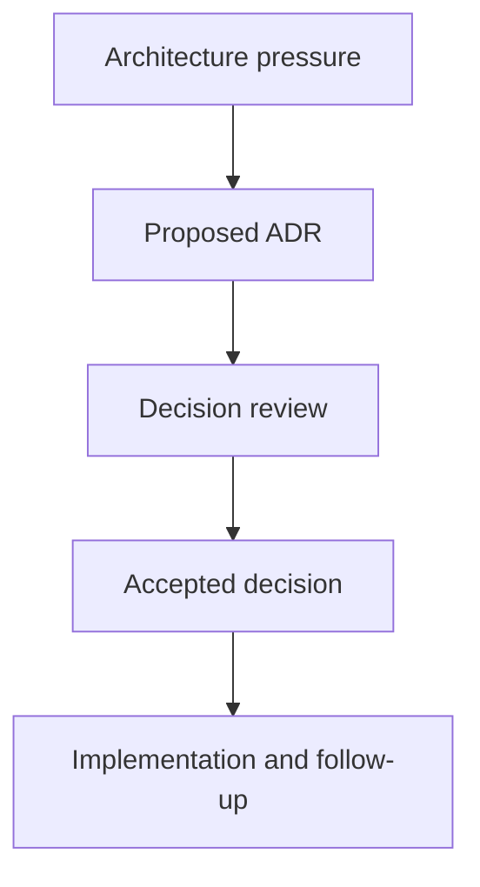

# Architecture Decision Records

This directory records durable architecture choices for ReadWise. ADRs are short, practical notes that explain the context, decision, trade-offs, and follow-up work for choices that future contributors may otherwise have to rediscover.

ADRs should generally be **kept**, not deleted, even after implementation. Update
their status and follow-up checklist when the code catches up. Use `Superseded`
only when a newer ADR replaces the decision.

## ADR lifecycle

## Index

Each ADR's frontmatter `status` tracks the document; the decision status
(Proposed, Accepted, Superseded) and related issues are in the ADR body.

<!-- BEGIN GENERATED: docs-index (npm run docs:index) -->

| Document | Type | Status | Description |
| --- | --- | --- | --- |
| [ADR-NNNN: Title](./0000-template.md) | template | template | Template for durable architecture decision records. Defines the expected ADR structure for context, decision, consequences, and follow-up. |
| [ADR-0001: PostgreSQL as the primary durable database](./0001-postgresql-primary-database.md) | architecture | accepted | Architecture decision record for database direction and SQLite/PostgreSQL parity. Captures decision context, chosen database posture, consequences, and migration expectations. |
| [ADR-0002: Explicit article visibility with centralized access checks](./0002-article-visibility-and-access-service.md) | architecture | accepted | Architecture decision record for article visibility and centralized access policy. Captures decision context, access-service design, consequences, and enforcement expectations. |
| [ADR-0003: Append-only admin and security audit logs](./0003-admin-security-audit-logs.md) | architecture | accepted | Architecture decision record for durable admin/security audit logging. Captures append-only audit-log decision, non-FK identifiers, metadata limits, and consequences. |
| [ADR-0004: Shared server-side rate limiting](./0004-shared-rate-limiting.md) | architecture | accepted | Architecture decision record for shared fixed-window counting and rate-limit policy. Captures DB/memory adapters, fallback window semantics, request scopes, and operational consequences. |
| [ADR-0005: Persistent job table before external queues](./0005-persistent-job-table-and-worker-locking.md) | architecture | accepted | Architecture decision record for the durable Job table and worker-locking model. Captures queue selection, claiming/locking strategy, retries, and external-queue deferral rationale. |
| [ADR-0006: AI invocation ledger, prompt versions, and budgets](./0006-ai-governance-ledger-and-budgets.md) | architecture | accepted | Architecture decision record for AI invocation governance, prompt versions, and usage budgets. Captures ledger metadata boundaries, budget strategy, prompt-version impacts, and consequences. |
| [ADR-0007: Object storage for generated and imported media](./0007-object-storage-for-media.md) | architecture | accepted | Architecture decision record for optional object storage and media metadata. Captures storage abstraction, graceful fallback, migration consequences, and media ownership. |
| [ADR-0008: Organization-ready tenant model](./0008-organization-ready-tenant-model.md) | architecture | accepted | Architecture decision record for organization-ready tenancy, memberships, classrooms, and assignments. Captures additive tenant model, role separation, soft references, and migration consequences. |
| [ADR-0009: Capability-based authorization layer](./0009-capability-based-authorization.md) | architecture | accepted | Architecture decision record for capability-based authorization. Captures capability vocabulary, role mapping, route guard posture, and consequences. |
| [ADR-0010: Subsystem boundaries and import contracts](./0010-subsystem-boundaries-and-import-contracts.md) | architecture | current | Architecture decision record for subsystem ownership, public APIs, private imports, and import-boundary enforcement. Captures current subsystem boundary contract, allowlist strategy, and phased enforcement expectations. |

<!-- END GENERATED: docs-index -->

Use [0000-template.md](0000-template.md) for new ADRs.

