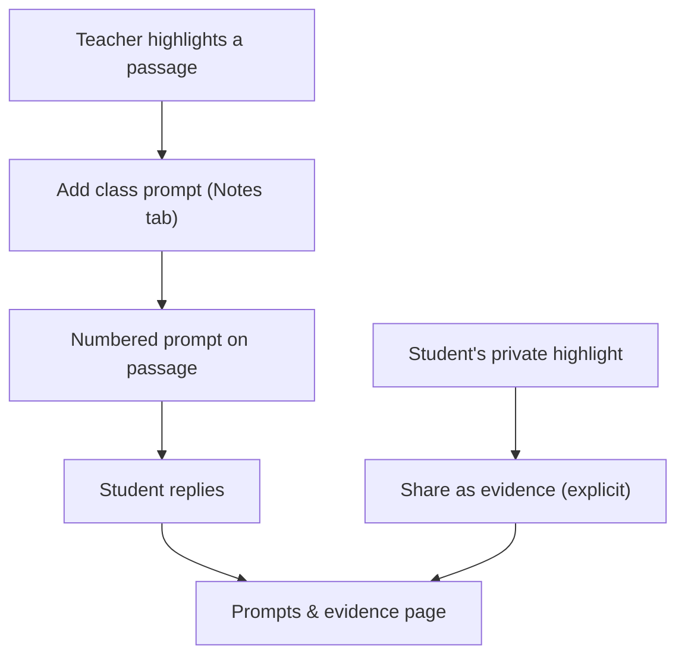

# Classroom annotations

Teachers can pin **guided prompts** to passages of an assigned article (for
example "Highlight the author's counterargument and explain why it matters").
Students in that assignment see each prompt on its passage in the reader,
reply to it, and can explicitly share one of their own highlights as
**evidence**. Teachers review replies and evidence per assignment.

## Code map

| Area | Code | Purpose |
| --- | --- | --- |
| Data | `AssignmentAnnotation`, `AssignmentAnnotationResponse` | Teacher prompts and learner replies/evidence, both assignment-scoped. |
| Domain | `src/lib/classroom/annotations.ts` | Reader context, prompt create/edit/delete, replies/evidence, withdrawal, teacher review. |
| API glue | `src/lib/classroom/annotations-http.ts`, `annotation-limits.ts` | Body schemas, limits, failure → status mapping. |
| Reader | `ReaderClassAnnotationsProvider`, `ClassAnnotationsPanel` (in `ReaderNotesPanel`), `ClassPromptsNotice`, `highlightMarks.ts` | Loads the context, lists prompts and actions in the Notes tab, paints `mark.rw-guide`. |
| Teacher UI | `/teacher/classrooms/[id]/assignments/[assignmentId]/annotations`; "Prompts & evidence (n)" on the classroom page | Review replies and evidence. |

## Data

Both tables use the same anchor selector as personal highlights (`quote`,
`startOffset`/`endOffset`, `prefix`/`suffix`; see
[annotations](../reader/annotations.md)).

| Model | Notes |
| --- | --- |
| `AssignmentAnnotation` | `assignmentId` (cascade), `authorId` (set null when the author is deleted), anchor, `prompt`. |
| `AssignmentAnnotationResponse` | `assignmentId` (cascade), optional `annotationId` (cascade — replies go with their prompt), `userId` (cascade), optional anchor (evidence), `body`. Needs a passage or text. |

Prompts and evidence also store the reading level whose text they anchor to
(`levelKey`). The reader paints only the current level's prompts inline; the
Notes tab lists every prompt, labelling ones anchored in another level's text
so learners locked to a level still see and answer them. Replies inherit their
prompt's level (see [reading levels](../reader/reading-levels.md)).

Limits: prompts 1,000 characters, replies/explanations 2,000, anchored
passages 2,000.

## Who sees what

| Viewer | Sees | Can do |
| --- | --- | --- |
| Classroom managers (teacher, org admin, system admin) | Prompts on assignments of the article in classrooms they manage; all replies and evidence on the review page | Create, edit, delete prompts (not in archived classrooms) |
| Students in the assignment (student role, targeting and publish state apply) | That assignment's prompts and their **own** replies/evidence | Reply, share evidence, withdraw their own responses |
| Anyone else (other students, other tenants, non-members) | Nothing | — |

- Personal `Highlight` rows are never read by this feature. A highlight (or its
  note) reaches a teacher only if the learner chooses **Share as evidence**,
  which copies the passage and an optional new explanation into a response —
  the private note is not copied.
- Learners never see other learners' responses. Teachers see them only on the
  assignment's review page.
- Unknown assignments, prompts from another assignment, and assignments the
  learner isn't part of return 404; non-managers get 403 for teacher actions.

## Reader

`ReaderClassAnnotationsProvider` loads `GET /api/reader/[id]/annotations` once
per article; a failure leaves the feature empty and the reader unchanged.

- **Inline:** prompts are painted after personal highlights as transparent
  `mark.rw-guide` elements with a dotted underline and a numbered badge on the
  first segment (`aria-description` "Teacher prompt N: …"). Marks only wrap
  existing text nodes, so anchors and Narration ranges are unaffected.
- **Notice:** `ClassPromptsNotice` under the assignment banner tells learners
  how many prompts exist and teachers how to add one, with an "Open class
  prompts" shortcut to the Notes tab.
- **Notes tab:** "Class prompts" lists prompts in document order with "Go to
  passage", edit/delete for managers, and reply forms for learners, plus the
  learner's shared evidence. Each personal highlight gets **Add class prompt**
  (teachers) or **Share as evidence** (learners).

## API

| Method + path | Body | Who |
| --- | --- | --- |
| `GET /api/reader/[id]/annotations` | — | Signed-in reader of the article |
| `GET /api/assignments/[id]/annotations` | — | Classroom managers (review) |
| `POST /api/assignments/[id]/annotations` | anchor + `prompt` | Classroom managers |
| `PATCH /api/assignment-annotations/[id]` | `{ prompt }` | Classroom managers |
| `DELETE /api/assignment-annotations/[id]` | — | Classroom managers |
| `POST /api/assignments/[id]/annotation-responses` | `{ annotationId?, anchor?, body }` | Students in the assignment |
| `DELETE /api/annotation-responses/[id]` | — | The response's author |

Prompt changes write `assignment_annotation.create`, `.update`, or `.delete`
audit rows in the same transaction with the assignment and classroom ids only.
Learner responses are personal content: never audited or logged, included in
the learner's personal-data export (`assignmentAnnotationResponses`), and
deleted with their account.

## Tests

| Test | Coverage |
| --- | --- |
| `tests/db/annotations.test.ts` | PostgreSQL: prompt CRUD and audit, RBAC and cross-tenant isolation, archived classrooms, audience (targeting, drafts, teacher-role members), replies/evidence validation, response privacy, withdrawal, cascades. |
| `tests/annotation-routes.test.ts` | Route auth, validation, status mapping, article access, audit wiring. |
| `tests/reader-highlight-marks.test.ts` | Guide mark layer painting and unwrapping. |
| `e2e/classroom-annotations.spec.ts` | Teacher prompt → student reply and evidence → teacher review → edit/delete; outsiders see nothing. |
