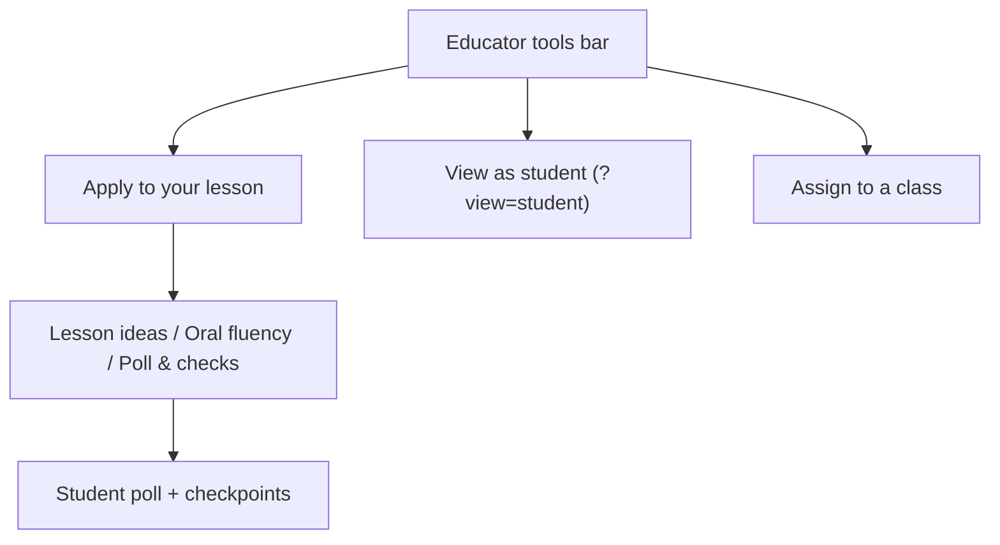

# Educator tools and reading activities

Teachers, content staff, and platform super-users get **Educator tools** on
`/reader/[id]`; their students get the **pre-reading poll** and **Checks for
Understanding** their teacher adds to an assignment.

## Code map

| Area | Code | Purpose |
| --- | --- | --- |
| Educators | `src/lib/classroom/educator.ts` | `isEducator` (also gates #1306 answer keys), managed classrooms. |
| Reader context | `src/lib/lesson/reader-context.ts`, page loader `educator` | Tools vs. preview, preview level lock, quick-assign classrooms. |
| Scaffolds | `src/lib/lesson/scaffold.ts`, `scaffold-fallback.ts`, `lesson-scaffold` prompt | Cached AI scaffolds; deterministic fallback. |
| Fluency | `src/lib/lesson/fluency.ts` | 100/150/200-word passages, WCPM/accuracy helpers, rubric. |
| Activities | `src/lib/classroom/activities.ts`, `activities-http.ts` | Polls, checks, votes, answers, teacher results. |
| Data | `ArticleLessonScaffold`, `AssignmentPoll`, `AssignmentPollVote`, `AssignmentCheck`, `AssignmentCheckAnswer` | |
| UI | `EducatorTools` (bar, preview banner, quick assign), `LessonSheet`, `ReaderActivities` (poll cards, checkpoints) | |

## Educator tools

- **Apply to your lesson** opens a sheet with three tabs:
  - *Lesson ideas*: a before-reading hook, discussion questions, and key terms.
    Generated once per article with the `lesson-scaffold` prompt and cached;
    without AI (or on failure) a deterministic scaffold is built from the title
    and the article's most frequent distinctive words with their sentences
    (labelled "Built from the article text", never cached).
  - *Oral fluency*: a 100-, 150-, or 200-word passage (the article's first N
    words, 12-word lines with cumulative word counts), the WCPM and accuracy
    formulas with accuracy bands, and **Print passage & rubric**
    (`/reader/[id]/print?mode=fluency&words=N`, educators only).
  - *Poll & checks*: for one of the educator's assignments of the article —
    the pre-reading poll (question + 2–5 options; saving changes clears votes)
    and Checks for Understanding (question, 2–4 choices, correct answer,
    optional explanation, placed after a chosen reading block), with class
    results.
- **View as student** reloads with `?view=student`: the educator bar is
  replaced by a preview banner, and the reader previews the educator's first
  assignment of the article: its reading-level lock and its poll and checks,
  as students see them. Preview responses stay in the browser.
- **Assign to a class** assigns the article to a managed classroom (optional
  due date) without leaving the reader.

## Student activities

- **Before you read**: each poll from the learner's live assignments of the
  article (student role, targeting, publish state) appears above the prose.
  After voting the learner sees only the class distribution — never who voted
  what. Votes can be changed.
- **Checks for Understanding**: when the reader scrolls past a check's block, a
  dismissible "Check for understanding" card appears; all checks are also
  listed after the article. The first answer is final; the correct answer and
  explanation are revealed only after answering.
- Checks are anchored by reading-block index (paragraphs, headings, list items,
  quotes) in the reading level the teacher was reading when adding them
  (`levelKey`). Only checks placed in the level being read pop up at their
  section; the rest are still listed after the article.

## Privacy and authorization

- Only classroom managers create, change, or remove polls and checks (403
  otherwise; 409 for archived classrooms) and see aggregate results.
- Students outside an assignment's audience, teachers, and other tenants can't
  vote or answer (404).
- Votes and answers are personal data: exported with the account
  (`assignmentPollVotes`, `assignmentCheckAnswers`), deleted with it, never
  audited or logged. Management changes write `assignment_poll.save|delete`
  and `assignment_check.create|delete` audit rows with ids only.

## API

| Method + path | Who |
| --- | --- |
| `POST /api/reader/[id]/lesson` | Educators (403 otherwise) |
| `GET /api/reader/[id]/activities` (`?preview=1` for educators) | Readers of the article |
| `POST /api/assignment-polls/[id]/vote` `{ optionIndex }` | Students in the assignment |
| `POST /api/assignment-checks/[id]/answer` `{ selectedIndex }` | Students in the assignment |
| `GET /api/assignments/[id]/activities` | Classroom managers |
| `PUT`/`DELETE /api/assignments/[id]/poll` | Classroom managers |
| `POST /api/assignments/[id]/checks`, `DELETE /api/assignment-checks/[id]` | Classroom managers |

## Tests

| Test | Coverage |
| --- | --- |
| `tests/db/activities.test.ts` | PostgreSQL: management RBAC/validation/audit, voting and answering, aggregate results, audience isolation, preview, educator detection and reader context, scaffold fallback and cache, cascades. |
| `tests/activity-routes.test.ts` | Route auth, educator gating, validation, status mapping, audit wiring. |
| `tests/lesson-helpers.test.ts`, `tests/lesson-scaffold.test.ts` | Fluency passages and scoring, fallback scaffolds, scaffold parsing and caching. |
| `e2e/educator-tools.spec.ts` | Teacher tools → preview → print; student vote and check; non-educators get nothing. |
