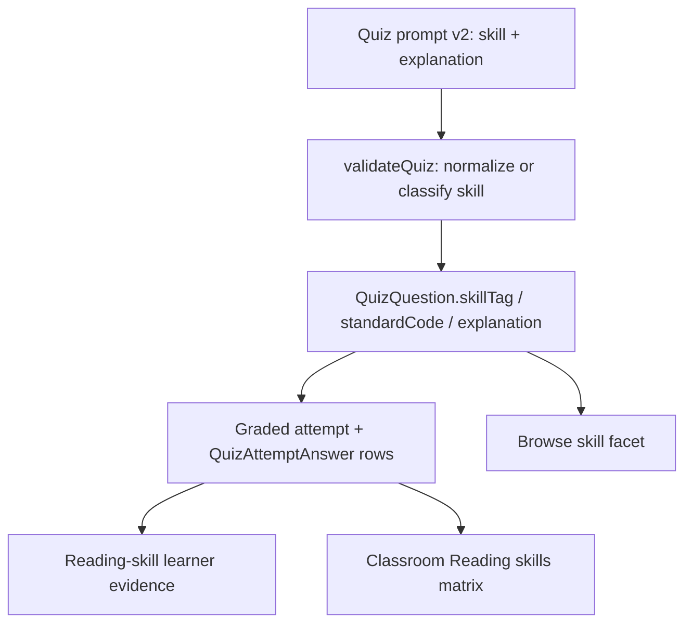

# Reading skills and maturity bands

Comprehension quizzes are tagged with the reading skill each question checks,
learners see the skill and a rationale after submitting, and teachers see
class performance by skill. Articles also carry a **content maturity band** —
age/topic suitability — that is independent of linguistic difficulty
(CEFR/Lexile). Browse filters on both.

## Code map

| Area | Code | Purpose |
| --- | --- | --- |
| Taxonomy | `src/lib/learning/reading-skills.ts` | Six skills, anchor codes, labels, ordered classification rules, `normalizeReadingSkill`. Client-safe. |
| Maturity bands | `src/lib/article-library/maturity.ts` | Bands, labels, "suitable for" expansion. Client-safe. |
| Quiz generation | `src/lib/ai/prompts/quiz.ts` (`quiz/v2`), `src/lib/ai/output/validators.ts`, `src/lib/quiz.ts` | Prompt asks for `skill` + `explanation`; validator normalizes/classifies; storage carries `skillTag`, `standardCode`, `explanation`, `id`. |
| Grading + answers | `src/lib/quiz-grading.ts`, `src/lib/learning/quiz-mastery.ts`, `/api/reader/[id]/quiz/attempt` | Per-question outcomes graded server-side and stored with the attempt. |
| Learner evidence | `src/lib/learning/reading-skill-evidence.ts`, `src/lib/learning/learner-evidence.ts` | Vocabulary-in-context → `vocabulary` mastery; main idea / inferential skills → coach-memory `main_idea` / `inference`. |
| Quiz UI | `src/components/ArticleQuiz.tsx` | Skill badge + rationale per question after submission. |
| Browse facets | `src/lib/browse-facets.ts`, `articleFacetFilters` in `src/lib/article-library/listings.ts`, `src/lib/recommendations/picks.ts`, `/api/articles`, `src/components/CategoryBrowser.tsx` | `?maturity=` and `?skill=` on category, search, and Picks views. |
| Editorial | `src/components/AdminArticleReview.tsx`, `POST /api/admin/articles/[id]/review` | Editors set an article's maturity band. |
| Classroom matrix | `src/lib/classroom/skills.ts`, `getScopedClassroomSkills` in `src/lib/analytics/classroom-access.ts`, `src/components/teacher/ReadingSkillsCard.tsx`, `GET /api/classrooms/[id]/skills` | Per-student × skill matrix with CSV export under analytics visibility rules. |
| Answer-key preview | `src/components/teacher/AssignArticleForm.tsx`, print answer key | "Preview answer key & skills" link per selected article; printed answer keys show each question's skill and rationale. |

## Reading skills

| Key | Anchor | Label |
| --- | --- | --- |
| `textual_evidence` | CCRA.R.1 | Cite textual evidence (default) |
| `main_idea` | CCRA.R.2 | Main idea & summary |
| `cause_effect` | CCRA.R.3 | Cause & effect |
| `vocabulary_in_context` | CCRA.R.4 | Vocabulary in context |
| `point_of_view` | CCRA.R.6 | Point of view & purpose |
| `argument` | CCRA.R.8 | Argument & claims |

- **Model-provided skills** are accepted as keys, labels, or anchor codes
  (`R.2`, `CCRA.R.2`). Anything else falls back to the deterministic
  classifier.
- **Deterministic classifier** — `classifyQuestionSkill` checks ordered keyword
  rules against the lower-cased question (vocabulary → main idea → argument →
  point of view → cause & effect), defaulting to textual evidence. Point of
  view is checked before cause & effect so "Why did the author…" reads as
  purpose.
- **Existing questions** were back-filled by the `20261117120000_reading_skills`
  migration with the same rules expressed as SQL `CASE … LIKE`, and every row's
  `standardCode` derived. `tests/reading-skills.test.ts` fails if the SQL and
  `READING_SKILL_RULES` drift apart; update both together.
- `standardCode` is always derived from `skillTag`, never trusted from the
  model. `explanation` is the model's rationale (≤ 600 chars) or null.

## Attempts and evidence

`POST /api/reader/[id]/quiz/attempt` grades the submitted option indices
against the stored quiz and writes the attempt with one `QuizAttemptAnswer`
per question (question index, skill, chosen index, correctness, and the
question id — cleared if the quiz is regenerated) in the same write. No
question or option text is stored with answers. After a new attempt,
best-effort learner evidence runs:

- vocabulary-in-context answers → `vocabulary` Skill Mastery (correct ratio,
  weight 0.5);
- main idea → coach memory `main_idea`; cause & effect, point of view, and
  argument → coach memory `inference` (correct ratio per attempt);
- textual evidence informs neither (it stays in the overall comprehension
  score).

Per-question answers are included in the personal-data export under each
quiz attempt and cascade with the attempt and the user.

## Content maturity

`Article.maturityBand` is `elementary`, `middle_school`, `high_school`, or
`general` (default for new and existing articles). Editors set it in the admin
article review form. A Browse filter means "suitable for": choosing a band
shows that band, younger bands, and `general` content.

## Browse facets

`/browse` and `/api/articles` accept `?maturity=` (elementary / middle_school /
high_school) and `?skill=` (a reading-skill key) alongside `level`, `q`, and the
category/Picks view. The skill facet keeps articles whose stored quiz has at
least one question for that skill (`quizQuestions.some`). Unknown values are
ignored. Category and search listings filter in the database (the cached
category listing keys on both facets); Picks filters its candidate set with one
id query before scoring.

## Classroom Reading skills matrix

`/teacher/classrooms/[id]` shows a **Reading skills** card: one row per
enrolled student and a class row, one column per skill, each cell the percent
correct (badge: ≥ 80% success, ≥ 50% warning, otherwise danger; "—" without
data). It counts each student's **most recent** attempt per assigned article,
so retakes replace earlier evidence. `GET /api/classrooms/[id]/skills` returns
the same matrix as JSON or CSV (`?format=csv`).

Visibility follows classroom analytics: the classroom's teacher and system
admins see per-student rows; an org admin sees class totals only. Others get
403; a missing classroom 404.

## Tests

| Test | Coverage |
| --- | --- |
| `tests/reading-skills.test.ts` | Taxonomy, classifier rules, normalization, migration/rules parity, maturity bands, facet parsing. |
| `tests/quiz.test.ts`, `tests/quiz-grading.test.ts`, `tests/quiz-mastery-lib.test.ts` | Validator skill/explanation, stored fields and legacy reclassification, per-question grading, nested answer writes. |
| `tests/reading-skill-evidence.test.ts`, `tests/learner-evidence.test.ts` | Evidence mapping. |
| `tests/article-library-read-models.test.ts`, `tests/recommendations-candidate-visibility.test.ts`, `tests/articles-route.test.ts` | Browse facets in listings, Picks, and the API. |
| `tests/content-review.test.ts` | Maturity band edits. |
| `tests/classroom-reading-skills.test.ts`, `tests/classroom-analytics-access.test.ts` | Matrix aggregation, redaction, export route, access. |
| `tests/db/reading-skills.test.ts` | PostgreSQL: answer persistence/cascade, matrix with a retake, facet queries. |
| `e2e/reading-skills.spec.ts` | Quiz review UI, Browse filters, teacher matrix + CSV. |
