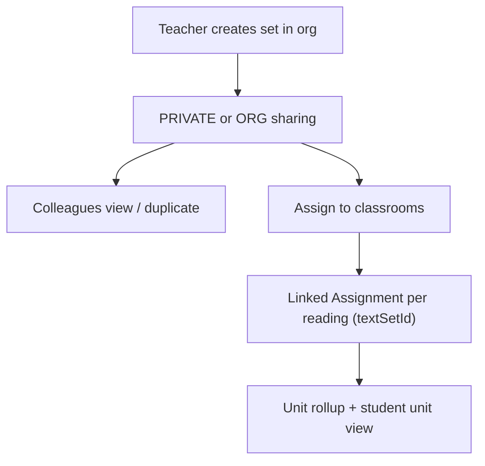

# Text Sets

A **Text Set** is an ordered group of articles for an instructional unit,
framed by an essential question, with student instructions, teacher-only notes,
and an optional guiding note per reading. Teachers create them inside an
organization, share them with colleagues there, and assign the whole set to
classrooms as a unit.

## Code map

| Area | Code | Purpose |
| --- | --- | --- |
| Data | `TextSet`, `TextSetItem`, `Assignment.textSetId` (Prisma) | Set metadata and visibility; ordered items with guiding notes; unit link on assignments. |
| Domain | `src/lib/classroom/text-sets.ts` | Authorization, list/detail, create/update/delete/duplicate, assign, unit rollups, org-scoped article search, assignable classrooms. |
| API glue | `src/lib/classroom/text-set-schemas.ts`, `src/lib/classroom/text-set-audit.ts` | Body schemas, failure → status mapping, request-scoped audit rows. |
| API | `/api/text-sets`, `/api/text-sets/[id]`, `/[id]/duplicate`, `/[id]/assign`, `/api/text-sets/article-options` | See below. |
| Teacher UI | `/teacher/text-sets` (Created by me / Shared at my organization), `/teacher/text-sets/new`, `/teacher/text-sets/[id]`; `TextSetEditor`, `TextSetActions` | Author, reorder, share, duplicate, delete, assign. |
| Classroom UI | `TextSetUnitsCard` on `/teacher/classrooms/[id]` | Unit-level progress. |
| Student UI | `groupAssignmentsByTextSet` in `src/lib/classroom/student-reads.ts`, `/assignments` | Readings grouped as a unit with the essential question and "N of M done". |

## Authorization

System admins pass every check. Otherwise:

| Action | Who |
| --- | --- |
| Create | A membership with `classroom.manage` (Teacher or OrgAdmin) in the set's organization. |
| View | The owner while still a member of the set's organization; for `ORG` sets, any Teacher/OrgAdmin of that organization. |
| Edit / delete | The owner while they can still author (Teacher/OrgAdmin) in that organization; for `ORG` sets, an org admin (`org.manage`) of that organization. |
| Duplicate | Anyone who can view **and** can author in the organization; the copy is `PRIVATE`, owned by them, titled "Copy of …". |
| Assign | Anyone who can view, into **active** classrooms of the set's organization that they manage (`canManageClassroom`). |

Sets in other organizations are invisible (404 / not-found page), never 403,
so their existence isn't disclosed. Students and plain members cannot list,
view, or author sets. Every item must be readable in the organization's
article context (`readableArticleWhere(articleAccessContext(user, orgId))`);
duplicates are collapsed, and a set holds 1–20 readings.

## Assignment and progress

Assigning creates one `Assignment` per reading per classroom, in set order,
with `textSetId` set and instructions = the set's student instructions plus
the item's guiding note. An article that is no longer assignable is skipped and
reported in the per-classroom `failed` count. Deleting a set keeps its
assignments (the unit link is cleared).

- **Classroom rollup** (`getClassroomTextSetUnits`): per unit, article count,
  students who completed every reading, and overall completion (completed
  student × reading pairs over expected pairs).
- **Student view**: `/assignments` groups a unit's readings (in set order) under
  the set title, classroom, essential question, and a done counter; other
  assignments follow.

## API

| Method + path | Body / query | Result |
| --- | --- | --- |
| `GET /api/text-sets` | — | `{ mine, shared }` summaries |
| `POST /api/text-sets` | `{ organizationId, title, essentialQuestion, description, educatorNotes, visibility: "PRIVATE"\|"ORG", items: [{ articleId, guidingNote }] }` | 201 `{ id }` |
| `GET /api/text-sets/[id]` | — | `{ textSet }` (with `canEdit`) or 404 |
| `PATCH /api/text-sets/[id]` | same fields as create, without `organizationId` | replaces fields and ordered items |
| `DELETE /api/text-sets/[id]` | — | `{ ok }` |
| `POST /api/text-sets/[id]/duplicate` | — | 201 `{ id }` |
| `POST /api/text-sets/[id]/assign` | `{ classroomIds: string[], dueDate? }` | `{ classrooms: [{ classroomId, created, failed }] }` |
| `GET /api/text-sets/article-options` | `?organizationId=&q=` | `{ articles }` (teachers of that org only) |

Failures: 400 (`empty_items`, `invalid_articles`, `invalid_classrooms`, body
validation), 403 (`forbidden`), 404 (`not_found`).

## Audit

Create, update, delete, and duplicate write `text_set.create`,
`text_set.update`, `text_set.delete`, and `text_set.duplicate` in the same
transaction as the change; assignment writes `text_set.assign` after the
assignments are created. Metadata holds ids and counts only (`orgId`,
visibility, item/classroom/assignment counts, source id) — never set titles,
questions, or notes.

## Lifecycle

Text sets are organization resources: deleting the organization deletes its
sets; deleting the author's account clears `ownerId` (org admins can still
manage shared sets). They are not part of the personal-data export
(`User.ownedTextSets` is an explicit exclusion).

## Tests

| Test | Coverage |
| --- | --- |
| `tests/db/text-sets.test.ts` | PostgreSQL: authoring rules, visibility and cross-org isolation, edit/duplicate/delete permissions, assignment and rollups, cascades, article search, audit rows. |
| `tests/text-set-routes.test.ts` | Route auth, validation, status mapping, audit wiring. |
| `tests/classroom-student-reads.test.ts` | Unit grouping and ordering. |
| `e2e/text-sets.spec.ts` | Build/share/assign in the UI, colleague vs other-org access, unit rollup, student unit view. |
