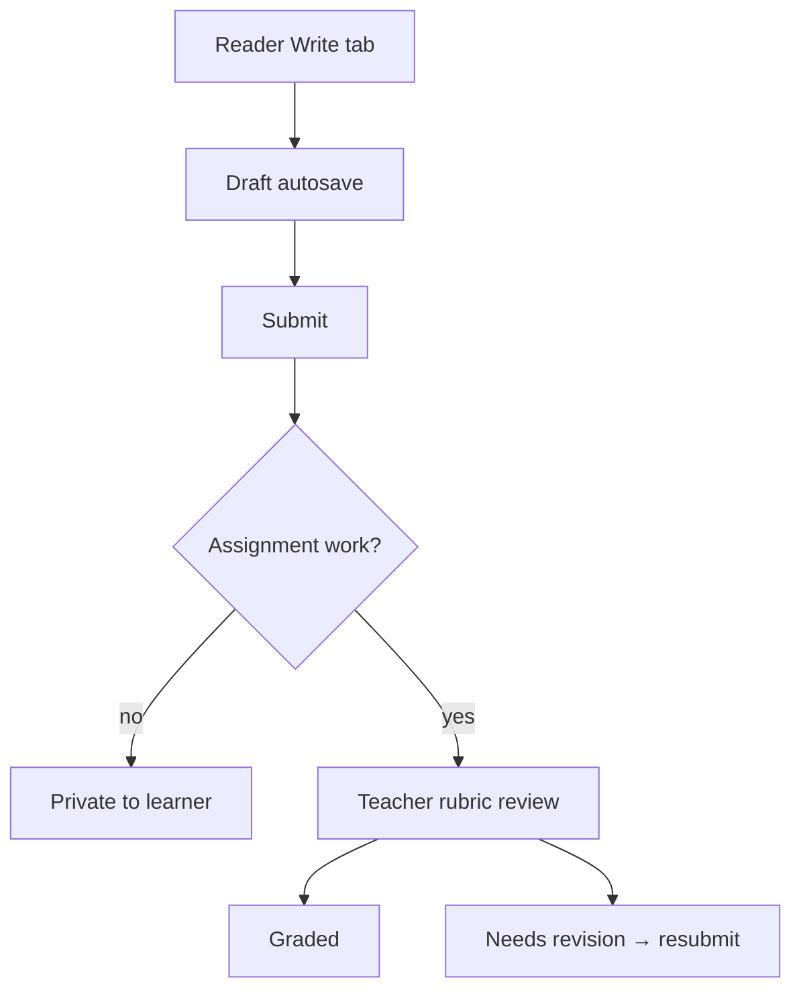

# Write prompts

Alongside the multiple-choice quiz, learners can write a constructed response
to an article's **Write Prompt** in the reader. Responses are either classroom
work (for an assignment of that article) or private independent writing.
Teachers score classroom responses on a rubric and either grade them or
return them for revision.

## Code map

| Area | Code | Purpose |
| --- | --- | --- |
| Data | `WritePrompt` (article default), `Assignment.writePrompt` (override), `WriteSubmission` | Prompts and responses. |
| Domain | `src/lib/classroom/writing.ts` | Context, autosave, submit, teacher listing, review, article default lookup. |
| Shared | `src/lib/classroom/writing-rubric.ts` | Rubric dimensions, statuses, limits, generic prompt, word count, score sanitizing. |
| API glue | `src/lib/classroom/writing-http.ts` | Body schemas and failure → status mapping. |
| Learner UI | `src/components/ArticleWrite.tsx` (Write tab in `ReaderTools`) | Scope picker, prompt, feedback, autosaving editor, submit/resubmit. |
| Teacher UI | `/teacher/classrooms/[id]/assignments/[assignmentId]/responses`, `WriteReviewForm`; "Written responses (n)" on the classroom page; prompt field in `EditAssignmentForm` | Review and prompt override. |
| Editorial | Admin article review form ("Default write prompt") | Article default prompt. |

## Prompts

The prompt for a response resolves in order: the assignment's `writePrompt`
→ the article's `WritePrompt` → a generic prompt naming the article. Each
response stores the prompt it started with (`WriteSubmission.prompt`), so later
prompt edits don't change what a learner is answering; the teacher page shows
the answered prompt when it differs from the current one.

## Responses and status

One `WriteSubmission` exists per learner, article, and scope (`scopeKey` = the
assignment id, or `"independent"`). The Write tab defaults to the learner's
first live assignment of the article (assignment targeting and publish state
apply) and offers "Just me (private)".

| Status | Meaning |
| --- | --- |
| `DRAFT` | Being written; autosaved about a second after typing stops. |
| `SUBMITTED` | Turned in. Assignment work is read-only until reviewed; independent writing can be reopened. |
| `NEEDS_REVISION` | Returned by the teacher with scores/feedback; editing keeps this status until resubmitted, and resubmitting increments `revisionCount`. |
| `GRADED` | Scored on every rubric dimension; read-only for the learner (teachers can re-grade or return it). |

Submitting requires at least one word. Bodies are limited to 20,000
characters, prompts to 1,000.

## Rubric review

Four dimensions scored 1–4: Claim & focus, Textual evidence, Organization,
Language & conventions. **Grade** requires every dimension; **Return for
revision** may carry partial scores. Feedback is optional. Only `SUBMITTED` or
`GRADED` responses can be reviewed (409 otherwise), and not while the
classroom is archived (409).

## Privacy and authorization

- Independent writing is visible only to its author — it never appears on a
  teacher page, and reviewing it returns 404.
- Assignment responses are visible to that classroom's managers (its teacher,
  an org admin, a system admin) once submitted; drafts never are. A response
  returned for revision is listed without its in-progress text until the
  learner resubmits. Anyone else gets 403; unknown assignments/submissions 404.
- Learners only ever read and write their own responses, and only for
  assignments in classrooms where they are a Student member (otherwise 404;
  co-teachers who are classroom members can't respond as students).
- If the assignment is deleted, the response keeps its text but loses the
  assignment link, so it becomes private to the learner.
- Response text and feedback are personal content: included in the learner's
  personal-data export, deleted with their account, never logged or audited.

## API

| Method + path | Body / query | Who |
| --- | --- | --- |
| `GET /api/reader/[id]/write` | `?assignmentId=` (omit for independent) | Learner (readable article) |
| `PUT /api/reader/[id]/write` | `{ assignmentId: string \| null, body }` — autosave | Learner |
| `POST /api/reader/[id]/write/submit` | `{ assignmentId: string \| null, body }` | Learner |
| `GET /api/assignments/[id]/submissions` | — | Classroom managers |
| `POST /api/write-submissions/[id]/review` | `{ action: "grade" \| "return", rubricScores, feedback? }` | Classroom managers |
| `PATCH /api/assignments/[id]` | `writePrompt` (empty restores the default) | Classroom managers |

Reviews write `write_submission.grade` or `write_submission.return` audit rows
in the same transaction, with the assignment/classroom ids and rubric totals
only.

## Tests

| Test | Coverage |
| --- | --- |
| `tests/db/writing.test.ts` | PostgreSQL: prompt resolution and snapshots, autosave/submit/lock/revise/resubmit, privacy of independent writing, drafts hidden from teachers, cross-classroom IDOR, review rules, audit, cascades. |
| `tests/write-routes.test.ts` | Route auth, validation, status mapping, article access, audit wiring. |
| `tests/writing-rubric.test.ts` | Rubric helpers. |
| `tests/content-review.test.ts` | Article default prompt edits. |
| `e2e/write-prompts.spec.ts` | Draft → submit → return → resubmit → grade, and independent privacy. |
