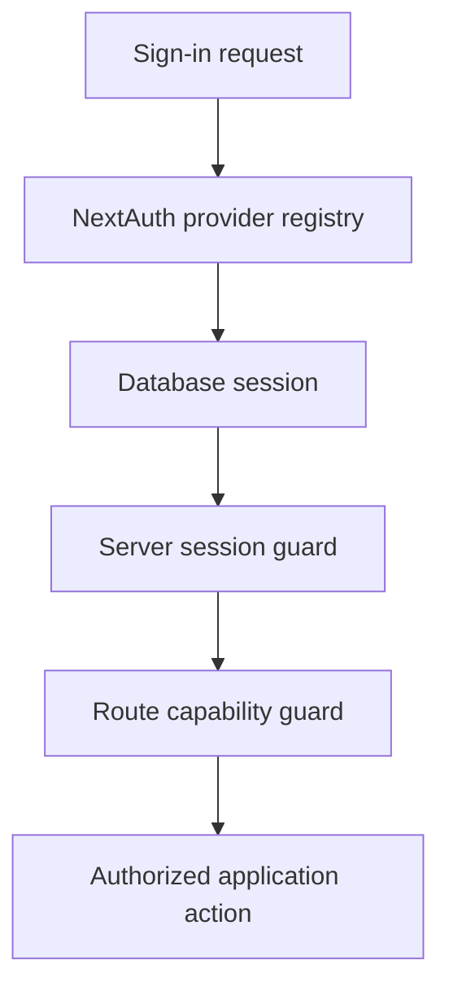

# Authentication architecture

ReadWise uses NextAuth v4 with database sessions. Authentication is intentionally
small at the framework boundary and capability-based everywhere else.

## Authentication flow


## Code map

| Area | Code | Purpose |
| --- | --- | --- |
| NextAuth config | `src/lib/auth/config.ts` | Adapter, providers, database-session strategy, cookies, and provider-safe callbacks. |
| Auth barrel | `src/lib/auth/index.ts` | Canonical re-export barrel for auth config (`authOptions`). |
| Provider registry | `src/lib/auth/providers.ts` | Env-driven Google/Azure AD provider construction and sign-in metadata. |
| Account Admission | `src/lib/account-admission/` | Password Credentials, invitations, public verification, recovery, social-linking policy, email, rate limits, and retention. |
| Bootstrap | `src/lib/auth/bootstrap.ts`, `scripts/bootstrap-admin.ts` | Explicitly create or recover the first global `Admin`. |
| Session core | `src/lib/auth/session-core.ts` | Load session and check capabilities with no redirects/responses. |
| Session guards | `src/lib/auth/session-guards.ts` | Redirect missing sessions to `/signin` and unauthorized users to `/forbidden`. |
| Page-level session facade | `src/lib/session.ts` | Re-exports session guards for page/layout-level ownership; keeps page imports short. |
| API guards | `src/lib/api-auth.ts` | Return `401`/`403` responses for route handlers. |
| Auth routes | `src/app/api/auth/**` | NextAuth social callbacks plus password registration, login, verification, and recovery. |

## Provider configuration

`buildProviders()` constructs providers only when their required env vars are
complete:

| Provider | Required env |
| --- | --- |
| Google | `GOOGLE_CLIENT_ID`, `GOOGLE_CLIENT_SECRET` |
| Azure AD | `AZURE_AD_CLIENT_ID`, `AZURE_AD_CLIENT_SECRET`, `AZURE_AD_TENANT_ID` |

Missing provider config is normal in local/test environments. The provider is
omitted rather than throwing. `getConfiguredProviders()` returns only provider id
and display name for server-rendered sign-in UI; it never exposes secrets.

OAuth providers cannot create Users. Unauthenticated provider sign-in requires
an existing exact provider link. Authenticated linking begins in Settings and
requires the provider's verified normalized email to match the current User.
Automatic email-based linking is disabled.

## Local sign-in and test sessions

### Normal local browser sign-in

The local app uses the same NextAuth provider registry as production. After
copying `.env.example` to `.env`, keep the required SQLite defaults and set:

- `NEXTAUTH_SECRET` to a generated value of at least 32 characters.
- `NEXTAUTH_URL` to `http://localhost:3000` unless you run the app elsewhere.
- `ACCOUNT_ADMISSION_MODE=invitation-only` (default) or `public`.
- SMTP settings when testing public registration or password recovery.
- A complete Google or Azure AD provider only when testing optional social
  linking/sign-in.

Provider setup is external to the repository:

| Provider | Local callback URL |
| --- | --- |
| Google | `http://localhost:3000/api/auth/callback/google` |
| Azure AD | `http://localhost:3000/api/auth/callback/azure-ad` |

Keep real client IDs, client secrets, tenant IDs, and generated NextAuth secrets
only in local env files or deployment secret stores. Do not commit them, paste
them into docs, or use placeholder non-empty values: incomplete providers are
omitted safely, while fake non-empty credentials can make sign-in attempt a
broken provider.

The sample content seed (`npm run seed -- --limit 3 --no-tts`) only creates and
enriches articles. It does not create users, accounts, sessions, OAuth links, or
cookies. Bootstrap a local administrator with `npm run bootstrap:admin`, then
sign in with email/password. See
[`../access/account-admission.md`](../access/account-admission.md).

### Explicit admin bootstrap

No first visitor or OAuth user is promoted automatically. Run:

```bash
printf '%s\n' "$READWISE_ADMIN_PASSWORD" |
  npm run bootstrap:admin -- --email admin@example.com --password-stdin
```

The command works only while no Admin exists. It creates a verified Admin or
promotes the matching existing User, and ensures that User has a Password
Credential.

### Playwright test-session path

For local smoke tests that need authenticated pages without configuring OAuth,
use the existing Playwright fixtures instead of hand-writing cookies or mutating
the development database:

- `playwright.config.ts` points the app at `PLAYWRIGHT_DATABASE_URL`, defaulting
  to the isolated SQLite URL `file:./e2e.db`.
- `seedSmokeData()` resets only a safe `e2e*.db` database and inserts
  deterministic article fixtures.
- `createUserWithSession({ role, onboarded })` inserts a fictional user and a
  database-backed NextAuth `Session` row.
- `addSessionCookie(context, sessionToken, expires)` injects the matching
  HttpOnly `next-auth.session-token` cookie into the Playwright browser context.

Run the smoke path with:

```bash
npm run test:e2e:smoke
```

This test-session helper is for Playwright/browser automation only. It is guarded
so destructive resets refuse production-like and normal development databases,
and the generated users/session tokens are local fictional fixtures. Do not copy
that pattern into production code, seed scripts, docs examples containing real
tokens, or shared local databases.

## Session strategy and cookies

`authOptions` uses the Prisma adapter and database sessions:

- `session.strategy = "database"`,
- `maxAge = 30 days`,
- `updateAge = 24 hours`.

Session cookies are explicit:

- HttpOnly,
- `SameSite=Lax`,
- `Secure` and `__Secure-` prefixed in production,
- path `/`.

Cookie names come from `SESSION_COOKIES` in `src/lib/route-policy.ts` so
middleware and NextAuth agree.

Password endpoints create the same database-backed Session rows and cookie
posture as NextAuth. The NextAuth Credentials provider is intentionally not
used because this project retains database sessions.

## Guard layering

Do not import framework-heavy auth helpers into client code. Use the narrowest
server-side guard for the surface:

| Surface | Helper | Failure behavior |
| --- | --- | --- |
| Pure/service code with loaded session | `sessionHasCapability(session, capability)` | Boolean deny-by-default. |
| Server components/pages | `requireSession`, `requireOnboardedSession`, `requireCapability` | Redirects to `/signin`, `/onboarding`, or `/forbidden`. |
| API routes | `requireSessionApi`, `requireCapabilityApi`, shared handler wrappers | Returns `401`/`403`. |
| Tenant/classroom routes | `src/lib/org/guards.ts`, `src/lib/classroom/guards.ts`, route helpers | Membership/capability-aware. |

Most API routes should use `createHandler`, `createAdminHandler`,
`createCapabilityHandler`, or `createPublicHandler` from
`src/lib/api-handler.ts` so validation, CSRF, logging, metrics, tracing, and
error aggregation remain centralized.

## Authorization is not authentication

Authentication establishes `session.user.id` and global `session.user.role`.
Authorization must still be enforced server-side through capabilities, article
access predicates, org/classroom guards, or owner checks. Middleware and hidden
UI are not security boundaries.

## Readiness and required env

Runtime config validation treats `NEXTAUTH_SECRET` and `NEXTAUTH_URL` as
required auth config. Optional OAuth providers report configured/degraded/
unconfigured independently in `/api/ready`. Account Admission and SMTP delivery
are also reported; see
[`health-readiness.md`](./health-readiness.md).

## Tests

Relevant tests include `tests/auth-core.test.ts`, `tests/auth-providers.test.ts`,
`tests/auth-bootstrap.test.ts`, `tests/auth-security-backend.test.ts`,
`tests/api-handler.test.ts`, `tests/rbac.test.ts`, and admin/tenant route tests.
