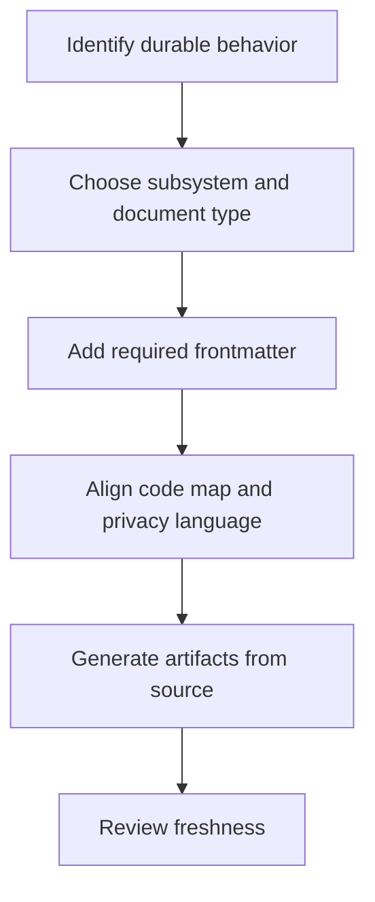

# Documentation governance and metadata

This document is the maintenance contract for `docs/`. It exists so every
reference document carries a small, predictable metadata block that describes
what kind of document it is, whether it is current, when it was last updated,
and what it covers — and so the indexes can be generated from those blocks
instead of maintained by hand.

## Tree layout

```text
docs/
├── README.md            entry point; its subsystem table is generated
└── <subsystem>/         one flat folder per subsystem (no nested folders)
    ├── README.md        scope, "Code ownership", generated document table
    ├── <topic>.md       durable documents
    └── *.json | *.csv   generated or template artifacts, linked from README.md
```

- Subsystems mirror the ownership model in
  [ADR 0010](../architecture/0010-subsystem-boundaries-and-import-contracts.md).
  A subsystem `README.md` has `type: "index"`, a one-paragraph scope, a "when to
  add a document here" sentence, a "Code ownership" list, and the generated
  block. Its `description` is the subsystem's row in `docs/README.md`.
- Only `README.md` lives at the docs root. Everything else belongs to exactly
  one subsystem; cross-link instead of duplicating content.
- Text between `<!-- BEGIN GENERATED: docs-index … -->` and
  `<!-- END GENERATED: docs-index -->` is written by `npm run docs:index` from
  each document's `# Title` and frontmatter. Never edit it by hand.

## Enforcement

`scripts/docs-index.ts` maintains and checks the tree:

| Command | Effect |
| --- | --- |
| `npm run docs:index` | Rewrites stale generated tables, then validates. |
| `npm run docs:check` | Validates only; exits non-zero on any problem. |

`tests/docs-structure.test.ts` runs the same validation in the unit suite, so CI
fails when a document has invalid frontmatter, a missing `# Title`, a broken
relative link, an unlinked artifact, a nested folder, a stray root file, or a
stale index.

## Documentation lifecycle


## Required frontmatter

Every Markdown document under `docs/` must start with YAML frontmatter:

| Field | Required | Meaning |
| --- | --- | --- |
| `type` | yes | Document type, not subsystem. Current values are `architecture`, `catalog`, `design`, `index`, `plan`, `policy`, `reference`, `runbook`, `template`, and `testing`. |
| `status` | yes | Document state. Current values are `current`, `accepted`, `generated`, `proposed`, and `template`. |
| `last_updated` | yes | Last documentation update date in `YYYY-MM-DD`. |
| `description` | yes | One or two short sentences (max 300 characters) describing what the document covers. It is shown in the generated indexes, so keep history and phase lists in the body. |

Every document also needs a `# Title` heading; it is the link text in the
generated index.

Do not put subsystem names in metadata. Subsystem placement is already encoded
by the flat path under `docs/<subsystem>/`.
Do not add `title`, `category`, `architecture`, `design`, `plan`, `updated`, or
`rename` fields to frontmatter; those concepts belong in the document body when
they are meaningful.

Generated Markdown must emit the same metadata from its generator. Currently
`docs/platform/api-catalog.md` is generated by `src/tools/api-catalog.ts`; do
not hand-edit generated metadata unless the generator changes too.

## Rename, merge, delete, or create decisions

Use this decision table before changing the docs tree:

| Situation | Action |
| --- | --- |
| The filename still matches the current subsystem and public concept. | Keep it; no metadata field is needed. |
| A document's topic split into two separately owned subsystems. | Create the missing subsystem doc and keep the old doc only for its remaining scope. |
| A document's content is now fully superseded by another durable doc. | Merge useful current content into the owner doc, delete the obsolete file, and fix all links in one change. |
| A document describes future-only behavior while code now implements it. | Update the body from roadmap language to current behavior, keeping any remaining roadmap items explicit. |
| A code feature has routes, models, tests, or UI but no durable reference. | Create a new flat `docs/<subsystem>/<topic>.md` file with this metadata schema. |
| No subsystem owns the behavior. | Prefer the closest existing subsystem. Add a new subsystem folder only for a new first-class subsystem (ADR 0010), with its `README.md` as described in [Tree layout](#tree-layout). |
| A file is generated. | Update the generator and regenerate the artifact; do not make one-off manual edits. |

If content no longer belongs to the document's `type`, move it to a document of
the right type. Examples: operational steps belong in a `runbook`; stable API or
schema behavior belongs in `reference`/`design`; testing strategy belongs in a
`testing` document; future work belongs in a `plan` or clearly marked proposed
design document. Rename the file only when the filename no longer matches the
remaining content after the move.

Renames are intentionally conservative. Broken incoming links are more harmful
than a slightly broad filename, so prefer updating scope language and cross-links
unless the old name is actively misleading.

## Content freshness checklist

When code changes, update docs in the same change set if any of these are true:

1. A public route, admin route, or API contract is added, removed, renamed, or
   changes auth/capability behavior.
2. A Prisma model, enum, cascade, retention rule, or privacy boundary changes.
3. A runtime configuration helper reads a new environment variable or changes a
   default.
4. A generated artifact changes (`api-catalog`, schemas, migrations, fixtures,
   eval datasets).
5. A feature gains user-visible UI, operator workflow, offline behavior, or new
   failure modes.
6. A document says "future", "not implemented", "schema-only", or "no API" for
   behavior that now exists in `src/`.

## Code maps are mandatory for feature docs

Feature and operations docs should include a `Code map` table listing the main
source files, API routes, scripts, tests, and generated artifacts. Code maps are
not a substitute for explaining behavior, but they make review and future audits
fast.

## Privacy and safety language

Docs must explicitly call out storage/logging boundaries for sensitive data.
Follow the project-wide rule: never log or persist secrets, credentials, tokens,
cookies, prompts, article text, selected text, definitions, translations, or
user-private content in metadata. If a feature stores only identifiers, counts,
controlled enums, or aggregate scores, state that plainly.

## Index maintenance

Indexes are generated. After creating, deleting, renaming, or re-describing a
document, run `npm run docs:index` and commit the regenerated `README.md` files
with the change. When a document is merged into another file, add a sentence in
the surviving doc explaining where the content now lives; edit only the
hand-written parts of a subsystem `README.md` (scope, code ownership, artifact
links).

