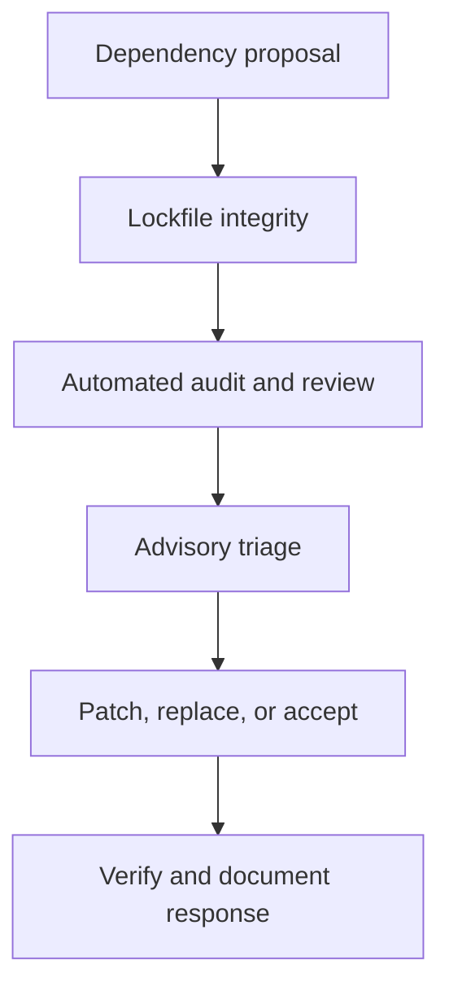

# Supply-chain and dependency hygiene

ReadWise depends on Next.js, Prisma, Azure SDKs, OpenTelemetry, NextAuth,
web-push, Playwright, scraper libraries, and AI/Speech providers.  This document
records the dependency hygiene policy, the automated CI gates, and how to respond
to vulnerability advisories.

Automated gates are defined in [`.github/workflows/ci.yml`](../../.github/workflows/ci.yml).
For general CI topology, see [`ci.md`](ci.md).

## Dependency governance


---

## Gates at a glance

| Gate | Where | Severity | Blocking? |
| --- | --- | --- | --- |
| **Lockfile integrity** (`npm ci`) | `supply-chain` CI job | n/a | **Yes** — hard fail |
| **Dependency audit** (`npm run audit:dependencies`) | `supply-chain` CI job | HIGH + CRITICAL | **Yes** — hard fail, with exact documented exceptions only |
| **Dependency review** | `dependency-review` CI job (PRs only) | HIGH + CRITICAL | **Yes** — blocks PR merge |
| **Dependabot security updates** | Automated PRs | all | PR opened automatically |

---

## Lockfile policy

`package-lock.json` is **committed** and is the single source of truth for the
dependency graph.

- Always commit `package-lock.json` alongside any `package.json` changes.
- Use `npm install` (not `--force`) to update the lockfile; never hand-edit it.
- `npm ci` — used in every CI job — fails immediately if the lockfile is absent
  or inconsistent with `package.json`.  This is the hard, zero-false-positive
  lockfile integrity gate.

**Fix for a drifted lockfile:**

```bash
npm install          # regenerates package-lock.json from package.json
git add package-lock.json
git commit -m "chore: sync package-lock.json"
```

---

## Vulnerability scanning (npm audit)

### Policy

| Severity | Action |
| --- | --- |
| **Critical** | Fix or mitigate before merging to `main`. Open a tracking issue immediately. |
| **High** | Fix or document an exception within one sprint. Blocks new PRs that _introduce_ the vulnerable package (via dependency-review). |
| Moderate | Triage within the current release cycle; fix when a non-breaking upgrade exists. |
| Low / Info | Fix opportunistically; no timeline required. |

### Current advisory state

The production dependency graph currently has no HIGH or CRITICAL advisories.
The `supply-chain` job runs `npm run audit:dependencies`, which evaluates both
the production and full `npm audit` JSON reports. Production findings always
fail. Full-graph findings also fail unless every blocking path resolves to an
exact exception below and the lockfile proves its additional constraints.

Exceptions live in the `ADVISORY_EXCEPTIONS` table in
`scripts/audit-dependencies.ts`. Each entry pins an advisory URL, the vulnerable
package, and its exact locked version. The wrapper accepts a full-graph finding
only when every blocking path traces back to allowlisted advisories and every
reported node of each cited package is dev-only at exactly the pinned version.
It rejects any production occurrence, other version, different advisory, broken
advisory chain, malformed report, or failed audit command.

The active exception is the dev-only `braces@3.0.3` advisory, which has no
patched release. The `brace-expansion@1.1.18` entry is now inert: the lockfile
carries 1.1.21, which npm no longer flags.

### Triaging a new advisory

1. Run `npm audit --json` and `npm audit --omit=dev --json` to
   identify the vulnerable package and its dependency path.
2. Check whether a non-breaking fix is available: `npm audit fix --dry-run`.
3. If fixable, apply it: `npm audit fix` (without `--force`) and commit the
   updated `package-lock.json`. Run `npm run audit:dependencies` to verify both
   graphs.
4. If **not fixable** (breaking change, no upstream fix, or false positive):
   - Open a GitHub issue labelled `security` describing the advisory, the
     dependency path, and why immediate upgrade is not feasible.
   - Document the exception in this file under [Exception log](#exception-log).
   - Add a narrow, test-covered rule to `scripts/audit-dependencies.ts` only
     when automated enforcement can prove the exception's package, version,
     dependency scope, and advisory identity. New findings discovered by
     `dependency-review` also block PRs that add or upgrade the affected package.

---

## Dependency review (new dependencies on PRs)

The `dependency-review` job runs `actions/dependency-review-action@v5` on every
pull request.  It **only** scans packages that are **added or changed** by the
PR diff — it does not rescan the entire existing graph.

- Fails on **HIGH** or **CRITICAL** severity vulnerabilities in newly introduced
  packages.
- Posts a comment on the PR with a summary of any findings.
- Does not require external credentials; uses the public GitHub Advisory Database
  via the built-in `GITHUB_TOKEN`.

If the action fails on a legitimate new dependency that carries a known advisory:

1. Evaluate whether an alternative package or a patched version exists.
2. If unavoidable, document the exception (see below) and update the PR
   description with a rationale.  A maintainer with write access can override the
   check by approving the PR.

---

## Dependabot automated updates

`.github/dependabot.yml` configures Dependabot to open pull requests for:

- **npm** — weekly (Mondays, 08:00 UTC); patch and minor updates are grouped to
  reduce PR noise; security updates are opened immediately regardless of schedule.
- **GitHub Actions** — weekly; keeps action pins up to date.

Dependabot PRs go through the same CI gates as any other PR, including
`dependency-review`.  Merge Dependabot security PRs promptly.

**Cadence targets:**

| Type | Target merge window |
| --- | --- |
| Security (any severity) | Within 3 business days of the PR opening |
| Major version | Manual review; no automatic open |
| Minor / patch | Within 2 weeks (or close if stale) |

---

## Secret scanning

GitHub's built-in secret scanning is expected to be enabled on the repository.
**Never** commit secrets, API keys, tokens, or connection strings to source code
or to this documentation.  Use GitHub repository secrets or `.env` files (which
are `.gitignore`-listed) for local development.

If a secret is accidentally committed:

1. Rotate the secret immediately.
2. Use `git filter-repo` (never `git filter-branch`) to remove it from history.
3. Force-push to all branches and notify affected services.

---

## License policy

All runtime dependencies must carry a permissive open-source licence (MIT, ISC,
BSD-2, BSD-3, Apache-2.0, or equivalent).  GPL-licensed packages are not permitted
in the production dependency tree without explicit approval.

To audit licences: `npx license-checker --production --summary`.

## Bundled third-party data

`src/data/wordfreq-en-ranks.ts` is generated by
`scripts/generate-wordfreq-ranks.ts` from the public
[`aparrish/wordfreq-en-25000`](https://github.com/aparrish/wordfreq-en-25000)
JSON export, which is derived from Robyn Speer's upstream
[`wordfreq`](https://github.com/rspeer/wordfreq) English data.

Attribution and licence notes:

- `wordfreq` code is Apache-2.0.
- `wordfreq` frequency data includes CC BY-SA 4.0-redistributable sources; keep
  attribution attached to any transformed/generated rank data.
- Credit Robyn Speer / `wordfreq` and retain links to the upstream `wordfreq`
  licence and notice files when redistributing generated data.
- The generated file stores only the filtered top-10k alphabetic English rank
  list used for deterministic CEFR/Lexile-like scoring; it does not contain
  article text or user-private content.

`deterministic-cefr/hybrid-calibrated-v4` uses opt-in
UniversalCEFR/elg_cefr_en evidence (CC BY-NC-SA 4.0) as full CEFR input plus
OneStopEnglish (CC BY-SA 4.0) as article-level ordinal anchors. No raw
calibration text is committed. ReadWise CEFR therefore remains
heuristic/hybrid-calibrated, and `lexileApprox` remains Lexile-like.
`scripts/difficulty-eval.ts` can consume local UniversalCEFR, OneStop-style, and
MIT Words-CEFR-style exports for aggregate calibration/audit reports, but those
source exports must stay outside the repository; reports and snapshots must not
include raw article text, titles, excerpts, article IDs, or word examples.
UniversalCEFR/elg_cefr_en, Cambridge, CEFR-SP, CC BY-NC, CC BY-NC-SA, and other
non-commercial calibration/vocabulary sources are disabled by default in the
harness and require an explicit `--enable-nc` opt-in; aggregate output marks such
sources with `nonCommercial: true` and license metadata.

---

## Exception log

Active exceptions are listed here. Each entry must include the advisory ID, the
affected package, the reason for deferral, and a target remediation date.

| Advisory | Package | Severity | Reason for deferral | Target |
| --- | --- | --- | --- | --- |
| [GHSA-vfj7-8cjw-p6xm](https://github.com/advisories/GHSA-vfj7-8cjw-p6xm) | `braces@3.0.3` | High | No patched release exists (3.0.3 is latest and affected). Dev-only, reached through `eslint-config-next` → `@next/eslint-plugin-next` → `fast-glob` → `micromatch` at lint time on trusted repository globs; not in the production graph. The CI wrapper proves exact version and dev-only scope. | Remove when `braces` ships a fix or `@next/eslint-plugin-next` drops `fast-glob`; review by 2026-11-13. |
| [GHSA-mh99-v99m-4gvg](https://github.com/advisories/GHSA-mh99-v99m-4gvg) | `brace-expansion@1.1.18` | High | Inert since 2026-10-13: the lockfile now carries 1.1.21, which npm no longer flags. Kept pinned to 1.1.18 so it cannot widen. | Delete the table entry and rule at the next audit-script change. |
