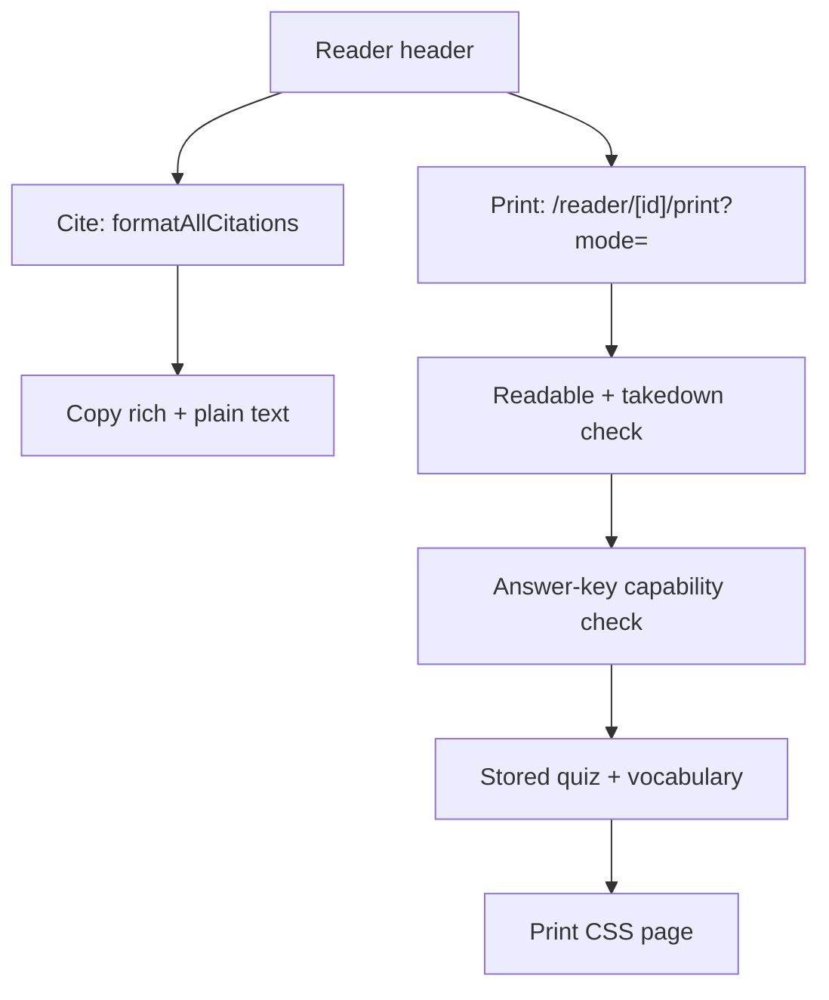

# Citations and printable packets

The reader header offers two classroom affordances next to Save and Offline:
**Cite** (copyable MLA 9, APA 7, and Chicago citations) and **Print** (a
chrome-free printable packet). Both work for every signed-in reader; only the
teacher answer key is gated.

## Flow

## Code map

| Area | Code | Purpose |
| --- | --- | --- |
| Citation formatter | `src/lib/citations.ts` | Pure, client-safe `formatCitation` / `formatAllCitations`, byline parsing, `articleCitationSource`. |
| Cite UI | `src/components/reader/CitationButton.tsx`, `CitationText.tsx` | Header button + popover; one-click copy per style. |
| Print modes | `src/lib/reader/print-modes.ts` | Client-safe modes, labels, `parsePrintMode`, option letters. |
| Print loader | `src/lib/reader/print.ts` | `canPrintAnswerKey`, `loadPrintableArticle` (readability, takedown, stored study material, MLA source line). |
| Print page | `src/app/(print)/reader/[id]/print/page.tsx` | Packet rendering; the `(print)` route group has no app shell. |
| Print toolbar | `src/components/reader/PrintToolbar.tsx` | Back link, packet layout picker, Print button (screen only). |
| Print styles | `src/app/styles/print.css` | Sheet layout, numbered paragraphs, `@media print` rules. |
| Header wiring | `src/app/(app)/reader/[id]/ArticleHeader.tsx` | Cite and Print actions in the meta row. |

## Citations

Inputs come from `Article` metadata: `title`, `author`, `source` (site name),
`publishedAt`, and `canonicalUrl` (falling back to `sourceUrl`). The access
date is "today". Dates are formatted in UTC; titles are kept as published (no
automatic sentence/title casing, since proper nouns can't be detected).

| Style | Shape (web/news article) |
| --- | --- |
| MLA 9 | `Last, First. “Title.” Site, 3 May 2024, host/path.` — URL without scheme, abbreviated months. |
| APA 7 | `Last, F. (2024, May 3). Title. Site. https://…` — title italic. |
| Chicago | `Last, First. “Title.” Site, May 3, 2024. https://….` (bibliography entry). |

Fallbacks:

- **Bylines** — a leading "By" is dropped; "A and B", "A & B", "A, B, and C"
  and semicolon lists are split. MLA uses `et al.` from three authors; APA
  lists up to 20 (then `. . .` + last); Chicago lists up to 10 (then the first
  seven + `et al.`). Single-word, organization-like, or digit-bearing names
  are kept as written; `Jr.`/`Sr.`/`II`–`IV` suffixes are preserved.
- **Corporate author** — a byline equal to the site name is omitted in MLA and
  Chicago; APA keeps it as the author and drops the repeated site name.
- **No author** — the entry starts with the title (APA moves the title into
  the author position).
- **No date** — MLA/Chicago add "Accessed …"; APA uses `(n.d.)` and
  "Retrieved …, from URL".
- **No site** — derived from the URL host; omitted when there is no URL.

The popover copies `text/html` (italics) plus `text/plain` through
`ClipboardItem` when available and falls back to plain text.

## Print packets

`/reader/[id]/print?mode=` (unknown modes print the article only):

| Mode | Contents | Who |
| --- | --- | --- |
| `article` | Title, byline, numbered paragraphs, MLA source line, rights note. | Any reader of the article |
| `worksheet` | Name/Date/Class header + article + vocabulary box + quiz bubble sheet + lined "Write about it" response. | Any reader of the article |
| `answer-key` | Worksheet + an answer key on a new page. | Teachers, content staff, super-users |

- **Answer-key authorization** — `canPrintAnswerKey` allows a global role with
  `articles.manage` (Admin, Moderator, ContentEditor) or `platform.superuser`,
  or any organization membership whose role grants `classroom.manage`
  (Teacher, OrgAdmin). Everyone else is redirected to `/forbidden`, and the
  layout picker does not offer the answer key.
- **Stored study material only** — the worksheet prints the article's stored
  `QuizQuestion` and `VocabularyItem` rows and never triggers an AI call. A
  missing quiz or vocabulary simply omits that section; the screen shows a
  hint to generate the quiz from the reader first.
- **Rights and takedown** — a non-`active` `takedownState` makes the article
  unprintable (a notice, no content), even for owners and admins who can still
  open it. A `rightsNote` is printed under the source line.
- **Access** — the article must be readable by the viewer
  (`getReadableArticleById`); otherwise 404. `/reader/:path*` is already a
  protected middleware prefix, and the page keeps its own session gate.
- **Styling** — the `(print)` route group renders no sidebar/header/bottom bar;
  the toolbar is `print:hidden`. In print media the sheet switches to the light
  scheme through the `Canvas`/`CanvasText` system colours (dark-theme readers
  still get black-on-white paper), quiz items avoid page breaks, and the answer
  key starts on a new page. Paragraph numbers use a CSS counter so
  textual-evidence questions can cite them.

## Privacy

Nothing new is stored or logged. Citations are computed per render; printing
reads only the article and its stored study material.

## Tests

| Test | Coverage |
| --- | --- |
| `tests/citations.test.ts` | All three styles; missing author/date; 2, 3, 20+, 10+ authors; corporate and organization bylines; suffixes and hyphenated names; URL/site fallbacks; punctuation; invalid dates. |
| `tests/reader-print.test.ts` | Mode parsing, option letters, answer-key RBAC matrix, takedown restriction, stored-only study material, rights note, canonical-URL citation. |
| `e2e/reader-print-citation.spec.ts` | Copying a citation; chrome-free print view and print-hidden toolbar; worksheet sections; answer key refused for a reader and shown to a teacher; restricted article. |
