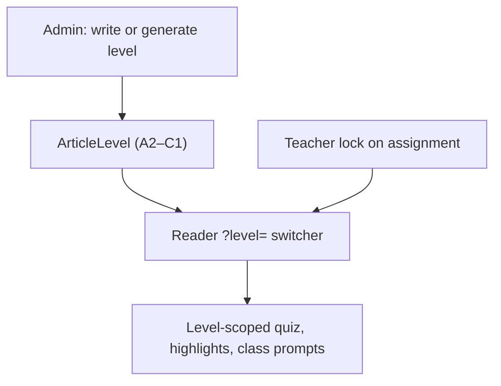

# Reading levels

An article can be read at several **reading levels**: adapted variants for
CEFR A2, B1, B2, and C1 (shown with a nominal Lexile-style band, e.g.
"B1 · ~850L") plus the **Original** text. Articles without variants behave
exactly as before — no switcher, no extra queries beyond one lookup.

## Code map

| Area | Code | Purpose |
| --- | --- | --- |
| Data | `ArticleLevel`; `levelKey` on `QuizQuestion`, `QuizAttempt`, `Highlight`, `AssignmentAnnotation`, `AssignmentAnnotationResponse`; `Assignment.lockedLevelKey`; `AssignmentCompletion.levelKeyRead` | Variants and level scoping. |
| Shared | `src/lib/article-levels/levels.ts` | Level keys, labels, hrefs, query helpers (client-safe). |
| Reads | `src/lib/article-levels/variants.ts` | List/get levels, reader level resolution, teacher locks, variant text helpers. |
| Authoring | `src/lib/article-levels/authoring.ts` | Save/delete levels, AI adaptation (`level-adapt` prompt). |
| AI text | `src/lib/article-levels/ai-text.ts` | Level text for the quiz generator. |
| HTTP | `src/lib/article-levels/http.ts` | `?level=` parsing and existence checks. |
| Reader | `ReaderLevelSwitcher`, `ReaderLevelContext`, page loader | Pills, provider wiring, prose/title/word count at the level. |
| Teacher | `ReadingLevelLockField` in the assign and edit assignment forms | Lock or leave unlocked. |
| Admin | `AdminArticleLevels` on `/admin/articles/[id]` | Edit, generate, delete levels. |

## Reader

- `?level=A2|B1|B2|C1|original` selects the level; unknown or missing levels
  fall back to the original text. The switcher (a "Reading level" nav of
  pills) appears only when the article has variants; the level matching the
  learner's profile CEFR level is marked recommended.
- A teacher lock wins: if one of the learner's live assignments of the article
  (student role, targeting and publish state apply) locks a level that exists,
  the reader shows it and replaces the pills with "set by your teacher".
- Switching levels keeps the article's identity: the same progress record,
  bookmarks, assignments, and history. The headline, prose, measured CEFR
  badge, and reading time come from the variant.
- Narration, dictation, and bilingual translations cover the original text, so
  adapted levels hide Listen and the bilingual strip, and the Dictate tab
  explains how to switch back. Vocabulary, Ask, and printing use the original.

## Level-scoped data

| Data | Scoping |
| --- | --- |
| Quiz | Each level has its own question set, generated from that level's text (`POST /api/reader/[id]/quiz?level=`). Attempts record `levelKey` (`/quiz/attempt?level=`). Editing a level's text clears its quiz. |
| Highlights | Offsets index the level's text; the unique key includes `levelKey`. Reader highlight APIs take `?level=` (GET/POST/PATCH/DELETE); `/notes` links each level highlight back to its level. Rescrapes only re-anchor original-level highlights. |
| Class prompts and evidence | Prompts and shared evidence store the level they anchor to; the reader paints only the current level's prompts and lists the rest in Notes; replies inherit their prompt's level. |
| Checks for Understanding | Each check stores the level it was placed in; it pops up only on that level and is listed after the article on others. |
| Printing | `/reader/[id]/print?level=` prints the level's title, text, and quiz (citation stays canonical); the assign form's answer-key preview uses a locked level. |
| Assignments | `lockedLevelKey` (null = student choice) validated against the article's levels. A quiz completes a locked assignment only at the locked level; completions record `levelKeyRead`. |

## Authoring

Content moderators manage levels on the admin article page. Each level is a
headline plus plain-text paragraphs separated by blank lines; the server
stores escaped `
` HTML and measures word count, Lexile-style estimate, and
CEFR with the deterministic difficulty scorer.

**Generate** queues a `LEVEL_ADAPT` job (deduplicated per article and level)
that rewrites the article with the `level-adapt` prompt. Without an AI
provider the button is hidden and the API answers 503 asking for manual entry;
a job that runs without AI completes as skipped. Generation never overwrites a
level unless regenerating. Audits record ids, level, and metrics — never text.

## API

| Method + path | Who |
| --- | --- |
| `GET /api/reader/[id]/levels` | Readers of the article (assignment form) |
| `PUT /api/admin/articles/[id]/levels/[level]` `{ title, text }` | `content.moderate` |
| `DELETE /api/admin/articles/[id]/levels/[level]` | `content.moderate` |
| `POST /api/admin/articles/[id]/levels/[level]/generate` `{ replace? }` | `content.moderate` (202, or 503 without AI) |
| `POST /api/classrooms/[id]/assignments`, `PATCH /api/assignments/[id]` | `lockedLevelKey` (classroom managers) |

## Tests

| Test | Coverage |
| --- | --- |
| `tests/db/article-levels.test.ts` | PostgreSQL: save/list/delete, quiz scoping and clearing, reader resolution and locks, lock validation, completion parity, level-scoped highlights and annotations. |
| `tests/article-levels.test.ts`, `tests/article-level-authoring.test.ts` | Helpers, parsing, authoring and AI adaptation outcomes. |
| `tests/article-level-routes.test.ts`, `tests/level-adapt-worker.test.ts` | Admin/reader routes, LEVEL_ADAPT handler. |
| `e2e/reading-levels.spec.ts` | Admin adds a level → reader switches → teacher locks → student reads the locked level. |
