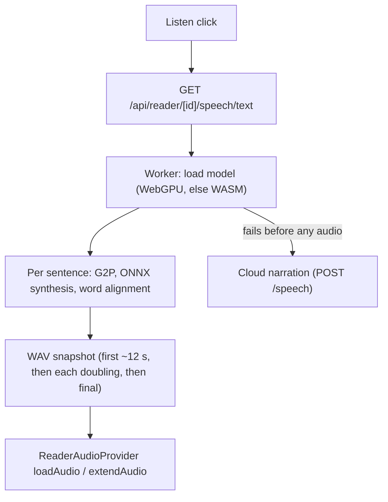

# On-device narration (Paradee-8M)

Reader narration is synthesized in the browser by default. The Listen button
runs [Paradee-8M v1.3](https://huggingface.co/sahilmahendrakar/Paradee-8M-v1.3)
(Apache-2.0, 7.9M parameters, distilled from Kokoro-82M) in a Web Worker and
plays the result through the Reader's single `<audio>` element, with the same
word highlighting, transcript, seeking, speed, and sentence-loop behaviour as
stored narration. The engine is ported from
[huangyingting/neural-readalong](https://github.com/huangyingting/neural-readalong)
(Apache-2.0), trimmed to the four English voices.

Stored cloud (Azure) narration remains available as a reader preference and as
the automatic fallback; see [`generation.md`](./generation.md) and
[`../reader/playback.md`](../reader/playback.md).

## Flow

1. `useNarrationApi.warmNarration` checks the `narration` reader preference
   (`"device"` by default) and that Web Workers and WebAssembly exist.
2. `GET /api/reader/[id]/speech/text` returns the article's full Narration text
   (`prepareNarrationText` with the full basis), so word offsets map onto the
   rendered prose exactly as stored narration does. It uses the readable-article
   guard only; no provider is called and no AI quota is spent.
3. `src/lib/ondevice-tts/client.ts` sends the text to one long-lived worker
   (`paradee.worker.ts`). The model loads once per page session and stays warm.
4. The worker splits the text into sentence chunks (≤ 200 characters, exact
   source offsets), phonemizes each with eSpeak-NG WASM plus Misaki symbol
   conversion, runs the model, and aligns words from Paradee's per-token
   duration frames (600 samples = 25 ms).
5. The client converts chunks to 16-bit PCM and publishes WAV snapshots: the
   first once about 12 s of speech exist, then whenever the generated audio
   doubles, then the full narration. Playback starts on the first snapshot.
6. `ReaderAudioProvider.extendAudio` swaps each longer snapshot into the
   `<audio>` element, restoring position, play state, and playback rate on
   `loadedmetadata`. Playback that caught up with synthesis resumes
   automatically. Superseded `blob:` URLs are revoked.

## Source order and fallback

`loadNarrationSource` (`src/components/reader/narrationSource.ts`) tries the
reader's preferred engine, then the other one:

- **On-device preferred:** if synthesis fails before any audio exists (model
  download, runtime, or synthesis error), the Reader requests cloud narration.
- **Cloud preferred:** if the speech API has no stored audio (`fallback: true`)
  or the request fails (network, rate limit), the Reader synthesizes on device.
  A cloud request error is surfaced as a retryable error only when on-device
  also produced nothing.
- **Cloud audio that fails to load** in the `<audio>` element (for example a
  missing stored file) switches to on-device through `recoverWithOnDevice`,
  once per article; a failing on-device `blob:` source marks narration
  unavailable.

Once on-device audio is playing, a later synthesis failure keeps the partial
narration. Leaving the page aborts synthesis and stops the worker.

## Execution device

The worker requests a WebGPU adapter. With an adapter it creates the ONNX
Runtime session with `["webgpu"]` alone (in `["webgpu", "wasm"]` ONNX Runtime
silently drops an unavailable WebGPU backend, which would misreport the
device); if session creation fails, or a WebGPU kernel fails at run time, it
rebuilds the session on WASM. Without
WebGPU it uses WASM directly. WASM runs single-threaded because the site is not
cross-origin isolated; measured at about 9× realtime on a server CPU.

At load time the ONNX graph is patched in memory, never re-exported: the
`/Clip_output_0` duration tensor becomes a graph output for word timing, and two
node patterns that break ONNX Runtime's WebGPU kernels are rewritten (a
negative-step `Slice` noise flip and all-zero `DequantizeLinear` zero points).

## Self-hosted assets

Nothing is fetched from Hugging Face or a CDN at runtime; `connect-src 'self'`
already covers every request.

| Path | Source |
| ---- | ------ |
| `/models/paradee-8m-v1.3/paradee_int8.onnx` | Committed INT8 model (8.5 MB), used for both WebGPU and WASM. |
| `/models/paradee-8m-v1.3/config.json` | Committed vocabulary and voice order. |
| `/models/paradee-8m-v1.3/LICENSE` | Model license (Apache-2.0). |
| `/_next/static/media/ort-wasm-simd-threaded.jsep.<hash>.wasm` | ONNX Runtime Web (WebGPU + WASM build, ~29.5 MB). The bundler emits it because `onnxruntime-web` resolves it with `new URL(..., import.meta.url)`; `wasmPaths` is deliberately left unset. |

The eSpeak-NG phonemizer ships inside the `phonemizer` npm package. Model files
are cached in Cache Storage (`ondevice-tts-paradee-v1`), outside the service
worker's `readwise-` prefix so service-worker upgrades and sign-out purges do
not force a re-download; the model holds no user data. Bump the cache name when
the hosted model changes.

The CSP allows `media-src blob:` for generated audio. WebAssembly compilation
relies on the existing `'unsafe-eval'` script source.

## Code map

| File | Purpose |
| ---- | ------- |
| `src/lib/ondevice-tts/client.ts` | Main-thread client: worker lifecycle, snapshot policy, abort. |
| `src/lib/ondevice-tts/paradee.worker.ts` | Worker: device detection, model load, chunked synthesis. |
| `src/lib/ondevice-tts/paradee.ts` | ONNX session, graph patch, phoneme runs, WebGPU→WASM fallback. |
| `src/lib/ondevice-tts/paradee-g2p.ts` | eSpeak-NG + Misaki G2P, ONNX Runtime helpers, cached asset fetch. |
| `src/lib/ondevice-tts/text-normalize.ts` | Spoken-form normalization (titles, years, times, money, decimals) shared by G2P and alignment. |
| `src/lib/ondevice-tts/word-timestamps.ts` | Sentence chunking with offsets; word alignment from duration frames with a character-proportional fallback. |
| `src/lib/ondevice-tts/narration.ts` | Aligned words → `SpeechWord` (punctuation trimmed), PCM and WAV encoding. |
| `src/lib/ondevice-tts/voices.ts` | English voice ids; `af_heart` is the default. |
| `src/app/api/reader/[id]/speech/text/route.ts` | Narration text for on-device synthesis. |

`client.ts` and `voices.ts` are the only modules the page bundle imports
(`client.ts` lazily); ONNX Runtime and eSpeak load only inside the worker.

## Reader preferences

Narration preferences are per browser, stored with the reader prefs in
`localStorage["readwise:reader-prefs"]`:

| Field | Values | Default |
| ----- | ------ | ------- |
| `narration` | `"device"`, `"cloud"` | `"device"` |
| `narrationVoice` | `af_heart`, `am_puck`, `bf_isabella`, `bm_fable` | `af_heart` |
| `narrationSpeed` | `0.5`, `0.75`, `1`, `1.25`, `1.5` | `1` |

Settings → Narration (`src/components/NarrationSettingsCard.tsx`) edits all
three and saves immediately; "Preview voice" synthesizes a short sample on
device with the chosen voice and speed. The Reader display panel keeps a quick
On-device / Cloud switch. Missing or invalid values resolve to the defaults.
Engine and voice apply the next time narration loads for an article; the
mini-player starts at the default speed and re-applies it whenever the audio
source loads.

## Privacy

Article text stays in the browser tab and worker; it is not sent to any
third-party service. Logs never include article text: on failure the Reader logs
only the error message (`On-device narration failed: …`) before falling back.

## Verification

- `tests/ondevice-tts-paradee.test.ts` synthesizes from the committed model on
  ONNX Runtime WASM in Node and checks audio, durations, and word offsets, plus
  the graph patch on synthetic protobufs.
- `tests/ondevice-tts-paradee-engine.test.ts` covers loading, WebGPU→WASM
  fallback, phoneme-run splitting, and voice selection with ONNX Runtime mocked.
- `tests/ondevice-tts-text.test.ts` and `tests/ondevice-tts-g2p.test.ts` cover
  normalization, chunking, alignment fallbacks, G2P, and cached asset fetch.
- `tests/ondevice-tts-client.test.ts` and `tests/ondevice-tts-worker.test.ts`
  cover snapshot publishing, abort and cancel, request superseding, device
  detection, and error reporting with the worker and engine faked.
- `tests/ondevice-tts-narration.test.ts` covers word mapping and WAV encoding.
- `tests/speech-text-route.test.ts` covers the text route.
- `e2e/ondevice-narration.spec.ts` clicks Listen in Chromium, then checks the
  self-hosted downloads, `blob:` playback, the prose word highlight, and
  snapshot swaps that keep position.
